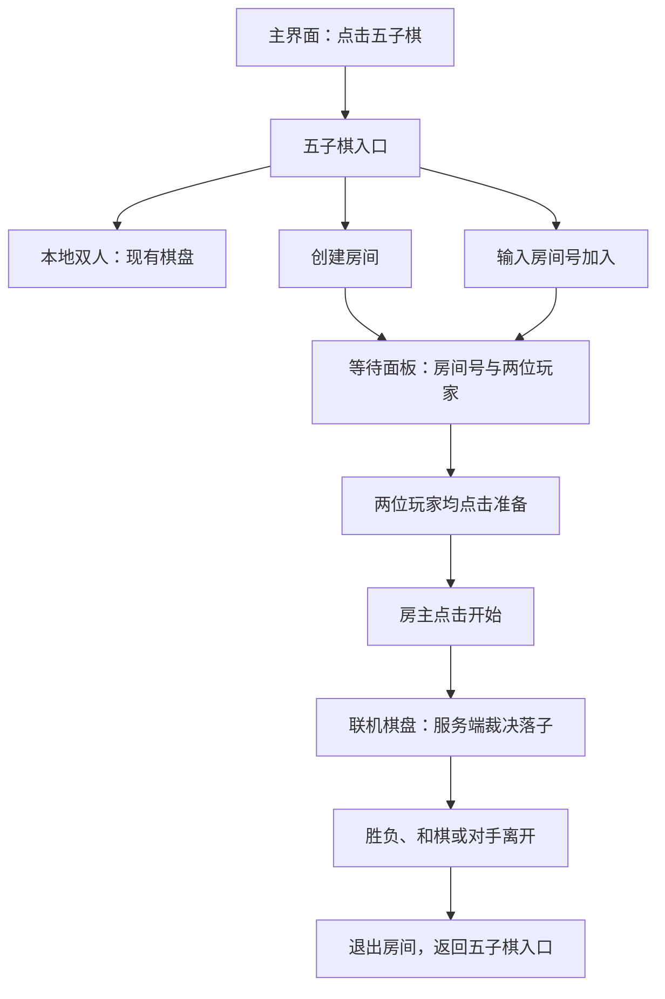

# 五子棋本地与 WSS 联机

从 `Unity/Assets/Scenes/Launch.unity` 启动并登录成功后，GameFlow 通过 GameScene 切换到
`Unity/Assets/Scenes/MainScene/Main.unity`，显示 `MainPanel`；点击“五子棋”打开 `GomokuLobbyPanel`，选择本地双人、创建房间或输入号码加入。
本地双人打开 `GomokuMainPanel`；联机双方准备、房主开始后打开 `GomokuOnlinePanel`。
右上角“退出”通过 `CloseSelf()` 返回主界面，不重新加载场景，缓存保留棋局。
本地模式为同机双人：黑方先行，双方交替落子，横、竖、两种斜线连续五子及以上获胜，
没有三三、四四和长连禁手。棋盘填满且没有获胜方时和棋。
点击已占用位置或终局后继续点击不会改变棋局；“悔一步”撤销最近一手，“重新开始”清空棋局。

## 职责和操作流程

所有业务代码位于 `Unity/Assets/Scripts/Hotfix/Gomoku`，不向 Runtime 添加业务层。

| 类型 | 职责 |
| --- | --- |
| GomokuGame | 纯 C# 棋局数据、执子方、合法性检查、四方向胜负、和棋、历史和悔棋；不依赖 Unity |
| GomokuBoardGraphic | 网格、星位和交点坐标计算 |
| GomokuBoardView | 点击转行列、棋子和最后落子标记、可用区域适配；不判断回合和胜负 |
| GomokuMainPanel | 本地操作协调、棋局创建、调用规则、刷新显示与状态文字、落子音效、按钮生命周期 |

本地流程是 `IntersectionClicked → GomokuMainPanel.ApplyMove → GomokuGame.PlaceMove → Render`。
被规则拒绝的落子不会刷新显示或播放音效。接受落子后，面板通过 GameAudio 播放一次落盘声；
悔棋、重开、缓存重新打开、布局调整和直接 Render 都不播放。操作包含行列和执子方，显示层不直接写棋盘数组。
联网模式使用独立 GomokuOnlinePanel：点击发送房间落子 RPC，RoomSession 统一应用响应 / Push 并重放权威历史，再刷新 BoardView；不调用本地面板的 ApplyMove。

棋局历史 `Moves` 为只读集合，按接受顺序保存行列和执子方。
可以通过 `new GomokuGame(size)` 和顺序 PlaceMove 重放历史，随后调用 BoardView.Render 恢复完整画面。
当前没有存盘；联机快照携带完整有界历史，重放用于重建显示。

## API 与错误语义

- `new GomokuGame(size)`：每个方向至少 2 个交点，小于 2 抛出 ArgumentOutOfRangeException。
  小于 5 路的棋盘不能形成五连，填满后和棋。
- `PlaceMove(column, row, stone)`：接受时返回 Accepted；GameFinished、WrongTurn、OutOfBounds、Occupied
  表示预期拒绝，棋盘、回合、终局状态和历史保持不变；空子或非法执子枚举抛出 ArgumentOutOfRangeException。
- `GetStone(column, row)`：返回空、黑、白；越界查询抛出 ArgumentOutOfRangeException。
- `UndoLastMove()`：空棋局返回 false；否则删除最后一手、恢复该手执子方和 Playing 状态。
  即使上一手结束了棋局，也可以撤销。
- `GomokuMainPanel.StartNewGame(pointCount)`：统一创建新棋局、修改网格规格并清空显示。
  在活动棋局中切换 18、20 路等规格必须走此入口。
- `GomokuMainPanel.ApplyMove(column, row, stone)`：应用操作并在接受后更新显示、播放音效；未创建棋局时抛出 InvalidOperationException。
- `GomokuBoardView.Render(game)`：按完整棋局更新显示。空棋局参数抛出 ArgumentNullException；
  资源引用缺失或棋局与网格规格不一致抛出 InvalidOperationException。

缓存关闭保留棋局，重新打开继续；重新开始才清空棋局。
按钮和棋盘事件只在 OnCreate 注册，销毁时由 LifetimeScope 解除；关闭和暂停期间停止接收棋盘点击。
棋子图片以 prefab 序列化引用提供，随 prefab 资源句柄保持有效，不另外持有异步加载句柄。
棋子对象在本面板内复用，重开和悔棋隐藏多余对象，面板销毁时随子节点释放。

## Prefab 与配置

`Unity/Assets/Prefab/Gomoku/GomokuMain.prefab` 的主要层级为：

```text
GomokuMain
└── GomokuBg
    └── Content                         SafeAreaFitter
        ├── Title / Subtitle / Status
        ├── BoardArea                   GomokuBoardView，棋盘可用布局区域
        │   └── Checkerboard            Image
        │       ├── Grid                GomokuBoardGraphic
        │       └── Pieces
        │           ├── Piece …         运行时按需创建
        │           └── LastMoveMarker
        ├── UndoButton
        ├── RestartButton
        └── ExitButton
```

Checkerboard 的 Image 提供底色，Grid 和 Pieces 均铺满 Checkerboard，棋子与标记关闭 Raycast Target。
Checkerboard 的 Image 接收射线，点击沿父层级传给 BoardArea 上的 GomokuBoardView；右键不落子。
BoardArea 没有 Graphic，不接收射线，棋盘外的布局空白不会触发落子。
点击转为 Grid 的局部坐标，取最近交点，最外圈线之外允许半格；超出允许范围返回 false。

在 Grid 的 Inspector 配置网格：

| 参数 | 默认值 | 含义 |
| --- | --- | --- |
| Point Count | 15 | 横竖各自的交点数量，可设置 18、20 等；运行中切换使用 StartNewGame |
| Padding Ratio | 0.05 | 每侧留白占棋盘较短边的比例 |
| Line Width / Border Width | 2 / 3 | 内线和外圈线宽，单位为 UI 局部单位 |
| Color | 深褐色 | 网格和星位颜色；不透明色避免交叉处叠加变深 |
| Show Star Points | true | 星位开关 |
| Star Radius Ratio | 0.08 | 星位半径占格距的比例 |

每个方向至少 9 个交点时，四个星位距离最外侧线 3 个间隔；奇数路额外绘制中央星位。
小于 9 路的奇数棋盘只有中央星位，偶数棋盘没有。星位仅为装饰，不改变规则。
网格按配置或尺寸变化重建 UI Mesh，不每帧生成对象。

BoardArea 的 GomokuBoardView 可设置 Maximum Board Size（默认 1000）和 Piece Size Ratio（默认 0.85）。
BoardArea 的 RectTransform 用锚点与边距定义 Content 中的可用范围，
默认 Min=(0.05, 0.2)、Max=(0.95, 0.8)，为上下信息和按钮留出空间。
Checkerboard 使用标准 Center 锚点，Min=Max=(0.5, 0.5)，Anchored Position 为零、Pivot 为中心。
实际棋盘边长取 Maximum Board Size、BoardArea 宽度、BoardArea 高度的最小值，
直接将 Checkerboard 的 sizeDelta 设置为相同的宽高，点击范围跟随实际棋盘。
Content 复用框架 SafeAreaFitter，方向不锁定。
GomokuBoardView 使用 ExecuteAlways，Prefab 编辑预览与运行时使用相同的正方形适配。
监听 BoardArea 的尺寸变化后调整棋盘和已落棋子，无每帧轮询。
尺寸回调位于布局容器，尺寸写入位于子棋盘，不需要自身尺寸回调的重入保护。
尺寸不变时不重复写入 sizeDelta；在 Inspector 修改 BoardView 配置后，下一次编辑器主线程回调刷新布局。
Checkerboard 的 sizeDelta 由布局管理；调整可用范围使用 BoardArea 的锚点和边距，
调整最大边长使用 Maximum Board Size，无需叠加 AspectRatioFitter 或其他尺寸控制组件。

GridRect 返回网格边界，CellSize 返回格距，GetIntersectionLocalPosition(column, row) 返回交点局部坐标。
行列从 0 开始，左下角为 (0, 0)，列向右、行向上；越界行列抛出 ArgumentOutOfRangeException。
棋子使用相同比例锚点，尺寸根据当前格距计算，红色小方块标记最后一手。

## 资源与验证

黑白棋子使用 `Assets/ArtRes/Gomoku/Image/BlackPieces.png` 和 `WhitePieces.png`，导入类型为 Sprite。
落子音效为 `Assets/ArtRes/Gomoku/Audio/GomokuPlace.wav`，合成的 0.16 秒落盘声（单声道 PCM）。
`GameAudioIds.GomokuPlace` 对应 `sfx.gomoku.place`，YooAsset 地址为 `GomokuPlace`。
Launch 引用共用的 `Assets/Config/Audio/GameAudioConfig.asset`，其中保留木鱼条目并加入落子条目：
Sfx 总线、Resident 启动预加载、音量 0.7、无冷却、最多 4 声并行，超限替换最早一声。
面板传递 OpenCancellationToken，关闭时取消尚未完成的播放请求，已经开播的短音效自然结束。
需要更换音色时替换同路径 WAV 并保留 `.meta`；音量在共用配置的落子条目中调整。
GameUIRegistration 注册 GomokuMain，DefaultPackage 的 Gomoku 组保持 `gomoku` 标签并增加 `boot`，
采集 Image、Audio 和 prefab；字体通过 prefab 依赖采集。主界面的五子棋按钮通过 GameFlow 注入的回调打开入口，本地玩法在入口中打开此面板。
正式包仍需重新编译 Hotfix DLL 并构建 YooAsset 资源包，不能仅更新 Editor 源码。

PlayMode 测试 GomokuGameTests 覆盖回合、非法落子、四方向胜负、白方胜利、长连、和棋、悔棋和历史重放；
GomokuPanelTests 覆盖指针输入、按钮、缓存重开、规格切换、区域缩放、坐标对齐、终局显示、Inspector 配置刷新和音效触发范围。

## 联机实施计划与当前实现（2026-10-14）

本节的 P0～P3 已实现：单 Game.Server 内存房间、已认证 WSS、两人联机 UI、权威落子与显式查询。
入口与等待共用 GomokuLobbyPanel，棋盘使用 GomokuOnlinePanel，保留本地玩法。P4 的实际 IL2CPP / 真机、弱网与持续压力验收仍待对应环境。
通用网络继续按 [NetworkDesign 第 18.1 节](NetworkDesign.md#181-当前优先路线底层框架完善)完善；进入联机实现前先确认所用 WSS 路径没有影响正确性的阻断问题。
采用 [第 22 节](NetworkDesign.md#22-etframework-可借鉴设计与-gameframe-实施提案)中的状态所有权、短锁提交和生命周期原则，首版交付单进程、两人、服务端权威的 WSS 五子棋。
实时世界、KCP 世界授权、AOI、Location、Router、自动匹配和自动重连不属于本计划首版。

### 1. 点击五子棋后做什么

点击 Main 的“五子棋”先打开五子棋入口面板，不自动创建房间。入口提供三个操作：

| 操作 | 玩家看到的行为 | 是否调用房间服务 |
| --- | --- | --- |
| 本地双人 | 打开现有 GomokuMainPanel，保留棋局、悔棋和重开行为 | 否 |
| 创建房间 | 请求成功后进入等待面板，显示房间号与“等待玩家加入” | 是 |
| 加入房间 | 输入房间号，请求成功后进入同一房间的等待面板 | 是 |

这样保留现有本地玩法，也避免只是查看入口就占用房间。首版通过房间号邀请，不做公共房间列表；知道房间号的其他已登录玩家可以尝试加入。
两个客户端必须连接同一个 Game.Server 实例；房间号不是跨服务器地址，也不是认证凭据。首版房间没有密码或好友限制，服务端仍检查账号、容量和房间状态。



示例：玩家 A 创建房间后看到 `03728461`，将号码告知玩家 B；B 点击“加入房间”输入号码。
A、B 的等待面板均显示两位玩家和准备状态，双方准备后 A 点击“开始”。服务端确认后双方进入同一棋局，A 执黑先行，B 执白。

### 2. 服务端如何创建房间

房间由 Game.Server 创建并持有，客户端只发起请求，不生成房间号或本地权威房间。

1. 处理器从当前 LobbySession 取得服务端认证身份；账号 ID、authEpoch 和 BindingId 来自现有绑定，不接受客户端自报身份。
2. 检查当前账号尚未处于其他五子棋房间、服务仍接受新业务、房间数量及创建速率未达到上限。
3. 在五子棋房间集合的同一提交边界内预留容量，生成房间实例标识和房间号，登记创建者为房主和第一位成员。
4. 初始化为 Waiting，双方准备状态为 false，棋盘规格固定为 15×15；创建成功不等于开始对局。
5. 返回成功结果及完整房间基线。客户端确认基线后才打开等待面板，显示号码和房主信息。

`roomCode` 是随机生成的 8 位数字字符串，保留前导零；生成时检查当前有效号码冲突，并限制生成尝试次数。
`roomId` 是不可与旧实例混淆的内部实例标识，后续操作同时检查实例与成员绑定。号码回收后即使分配给新房间，旧实例请求也不能作用于新房间。
集合维护 `roomId → 房间`、`roomCode → roomId` 和 `accountId → 当前成员资格`，三者的登记、加入和删除必须保持一致；每个账号最多属于一个五子棋房间。
首版房间仅保存在服务进程内存，服务重启后消失，不新增房间数据库或跨进程路由服务。

### 3. 其他玩家如何加入

1. 玩家 B 输入恰好 8 位数字的房间号；客户端校验输入格式，提交期间禁用重复操作。
2. 服务端校验认证身份，按号码查找有效房间；号码只用于查找，不能跳过授权、成员与容量校验。
3. 在集合与房间的统一提交规则下检查：房间处于 Waiting、只有一位成员、B 不是房主且未在其他房间。
4. 原子占用第二个席位、登记当前认证绑定、推进房间版本，双方准备状态重新置为 false。
5. 返回 B 的完整房间基线，同时通知 A 最新房间状态；A、B 都看到相同成员列表。

若 B、C 同时加入最后一个席位，只允许一人成功；另一人收到“房间已满”，不能覆盖已加入成员。
满房、已开局、已结束、房间不存在、已在其他房间和未登录均有明确结果。业务拒绝不关闭正常账号连接，也不伪装成成功。
成功成员重复查询返回现有房间；重复加入同一成员不增加人数。加入失败停留入口，不自动创建房间、不转入其他房间。

### 4. 准备、开始和落子规则

| 项目 | 首版规则 |
| --- | --- |
| 人数与规则 | 每房间最多 2 人，15×15 自由五子棋，五连及以上获胜，无禁手；满盘无胜方为和棋 |
| 执子方 | 房主执黑，第二位玩家执白；由服务端分配 |
| 准备 | 双方各自点击准备，也可取消准备；成员变化清除双方准备状态 |
| 开始 | 仅房主可请求，必须恰好两名有效成员且均已准备；服务器成功提交后才进入 Playing |
| 落子 | 请求包含房间实例、命令标识、预期棋局版本和坐标；服务端推导执子方并校验回合、坐标和占用 |
| 显示 | 客户端等待权威状态后更新棋盘，不先提交本地落子或预测胜负 |
| 悔棋、重开 | 本地模式保留；首版联网模式隐藏或禁用，后续实现双方同意的独立协议 |
| 再来一局 | 首版结束后退出房间，再创建/加入新房间；不在 Finished 状态直接重置旧棋局 |

服务端房间状态为 `Waiting → Playing → Finished → Closed`，Waiting 也可以因房主离开、过期或服务停止直接 Closed。
Finished 保留结果供成员查看，禁止继续落子和加入新玩家；Closed 从房间集合与成员索引移除。
客户端另外表达提交中、同步中和请求结果未确认，不能拿面板是否打开作为服务端房间状态。

### 5. 客户端与服务端如何同步

首版采用有上限的完整房间快照，包含房间实例、成员与准备状态、棋局状态、版本、下一执子方、结果和最多 225 手历史。
加入/查询返回基线；成员、准备、开始、落子和终局提交后，通过现有可靠 WSS Push 通知成员。棋盘小且操作频率低，先用完整快照简化同步，测得成本后再考虑增量事件。

- 每次有效状态提交增加房间版本；客户端只应用同一房间实例和当前成员资格下的新版本。重复或较旧快照不回退模型，也不重复播放落子音效。
- 入房响应和 Push 可能来自不同提交路径，不能假定调用顺序天然保证基线先到。入房输出携带本次成员准入操作标识；基线到达前只保留本次操作的最新一份受限完整快照，基线确认后按版本选取较新状态。
- RPC 和 Push 均经过同一个客户端房间会话更新模型，然后通知 UI；响应与推送重复携带同一次状态时只应用一次。
- 返回旧账号、旧房间、旧成员资格或已停止流程的结果不得更新模型。基线重建只刷新显示，不逐手播放音效。
- 所有玩家看到同一服务端裁决结果；客户端规则用于重建显示和一致性校验，不充当联网裁判。

协议位于 `Protocol/Gomoku/`，由现有工具生成双端 DTO / codec / catalog。RPC opcode 为 3000～3006，可靠 Push 为 3010 / 3011；请求正文上限 128 字节，响应 / 快照上限 4096 字节。

| 协议 | 方向 | 用途 |
| --- | --- | --- |
| CreateGomokuRoom | RPC | 创建并成为房主，返回房间基线 |
| JoinGomokuRoom | RPC | 按号码加入，返回成员资格与房间基线 |
| QueryMyGomokuRoom | RPC | 查询本人当前成员资格、房间状态与关联命令结果；不存在时明确返回 None |
| SetGomokuReady | RPC | 设置本人准备状态 |
| StartGomokuGame | RPC | 房主请求开始 |
| PlaceGomokuMove | RPC | 请求落子，返回提交结果与版本 |
| LeaveGomokuRoom | RPC | 退出并确认本人资格已解除 |
| GomokuRoomSnapshot | 服务端可靠 Push | 完整的最新房间状态 |
| GomokuRoomClosed | 服务端可靠 Push | 房间终止、本人资格失效和原因 |

复用现有 proto → MemoryPack DTO/codec/catalog 生成入口；不手写生成类型，不修改 GFNP，也不将五子棋塞进实时世界候选输入或状态设计。
数组、字符串、历史和响应体上限均显式声明，并验证最大快照的编码长度；协议变更后同步生成双端和辅助产物，旧客户端/服务端按既有握手协议不匹配规则拒绝。

### 6. 退出、断线和请求未确认

| 发生时机 | 首版服务端行为 | 客户端行为 |
| --- | --- | --- |
| Waiting：房主离开或断线 | 解散房间，解除双方成员资格 | 来宾显示原因后返回五子棋入口；本人认证失效则按 GameFlow 返回登录 |
| Waiting：来宾离开或断线 | 移除来宾、清除准备，房主继续等待 | 房主恢复“等待玩家加入”，可邀请其他玩家 |
| Playing：主动退出或断线 | 未结束棋局判该玩家负，另一方胜；解除离开者资格，剩余成员查看 Finished 结果 | 禁止后续落子，显示退出/断线终局原因 |
| Finished：成员离开 | 移除该成员；最后一人离开即关闭房间 | 返回五子棋入口 |
| 服务停止或房间故障 | 对局中止，不伪装成正常胜负；清理全部房间与绑定 | 显示服务不可用；连接失效后返回登录 |
| Waiting 超期 / Finished 保留期到期 | 关闭房间、通知成员、归还容量 | 清除成员资格并返回入口 |

首版不保留断线恢复席位，不提供自动重连；服务器确认连接关闭或账号撤销后执行离场，短暂抖动不直接等同于已确认断线。
对同时退出或断线，按房间提交顺序确定首个终局；后续清理不得改写胜负。尚未获得结果的玩家重新登录后不恢复旧棋局，战绩持久化另行实施。
顶号、注销、账号到期同样结束旧成员资格；清理通知携带旧 BindingId/成员实例，只清理匹配绑定，不能把重新登录后新建房间的玩家移除。

创建、加入、准备、开始、落子和退出请求都可能“服务端已提交，但客户端尚未收到确认”。本地取消或 RPC 超时不能证明未提交，也不能回滚棋局。
客户端进入“结果待确认”，暂停新的冲突操作，提供玩家显式点击的“查询状态”；通过 QueryMyGomokuRoom 对齐权威状态后才能继续，不自动重发原命令。
命令标识绑定账号、操作类型和内容摘要；重复同一命令最多提交一次，复用标识但改变内容明确拒绝。命令 ID 在同一认证绑定中严格递增；服务端保留最大已见 ID，近期缓存过期或淘汰后，旧 ID 返回 UnknownCommand，绝不重新执行。
每绑定最多 32 条近期结果、120 秒 TTL，指纹为固定 SHA-256；Query 即使结果 Unknown，仍返回该绑定当前房间状态。缓存与最大已见 ID 在解绑时释放，旧绑定不能重新使用。
确认服务端已离开后才完成正常退出导航；退出未确认时保留查询入口。普通关面板不是退出房间，最终清理由业务流程处理。

### 7. 代码落点与已有系统组合

下表为当前实现落点；UI 参数、资源与生成绑定已接入现有系统。

| 位置 | 职责 |
| --- | --- |
| 现有 GomokuGame 纯规则源码 | 以同源编译方式供 Hotfix 和 Game.Server 复用，核对命名空间与测试；服务端只编译纯规则文件，不引用 Unity 或整个 Hotfix 程序集 |
| DotNet/Game.Server/Gomoku | 五子棋房间、受限集合与成员索引、命令处理和结果；不引入通用 Actor 平台 |
| 现有 LobbyApplication / LocalWssService | 注入同一房间服务、显式注册协议、管理业务启动和停止 |
| 现有 LobbySession / 账号撤销链 | 把关闭与撤销交接给五子棋成员清理，保留认证模块的业务边界 |
| Hotfix/Gomoku/GomokuRoomSession | 普通实例，借用 GameLoginSession 的 WSS，持有唯一网络订阅、房间模型、在途任务和成员资格 |
| 现有 GameEntry / GameFlow / MainPanel 参数 | 入口拥有房间会话，流程负责业务进入退出；MainPanel 通过注入回调打开五子棋入口，不查询静态会话或直接访问 GameEntry |
| GomokuLobbyPanel（入口与等待共用） | 创建与加入入口、等待与准备面板；通过参数借用房间会话 |
| GomokuOnlinePanel | 联网棋盘操作与结果显示，复用 BoardView、BoardGraphic、棋子和音效；与本地面板分别管理操作语义 |

服务端采用短锁同步提交：集合、房间、成员索引与近期结果共用短锁，提交另持有 Binding.CommitGate，与账号撤销同步；顺序固定为房间集合 → 绑定，房间不获取 AccountSessions 索引锁。
提交时复核有效认证绑定、成员资格、预期版本与棋局状态；明确账号撤销和提交的仲裁点，不能只在处理器入口验权。
锁内不 await、不访问数据库、不编码或发送网络数据、不完成外部 continuation。单个被跟踪的 PeriodicTimer 驱动每 50ms 清理并输出；每绑定只保留最新完整快照，可合并未发送的中间版本。锁外编码 / Push，不等待 socket；可靠输出准入失败结束对应连接，其成员按断线清理。

客户端继续使用 GameUI 的面板栈，五子棋联机不新增 Unity 场景。RoomSession 先更新模型，再通过实例 Changed 事件通知面板，无需全局消息转发。
FSM 可组织入口、等待、对局和结束阶段；异步 RPC 仍由业务对象跟踪，不能把异步任务放进同步 OnEnter/OnExit 后就认为停止已等待完成。
OpenScope 管当前面板的 UI 订阅、刷新 Timer 与请求取消；隐藏/暂停期间另行停止输入。房间网络订阅活到房间会话结束，不随临时面板隐藏而丢失。
GameTimer 可用于等待 UI 展示；服务端过期判定使用服务端单调时间及被跟踪的清理驱动，不使用 Unity 时钟，不启动实时世界 tick。

停止顺序：禁止新房间操作和导航 → 关闭相关 UI/取消面板请求 → 等待自有任务并释放房间订阅 → 释放账号会话 → 关闭网络宿主与框架。
服务端先停止房间新准入，保留退出/解绑清理能力；join 网络 handler/Closed 后再结束房间清理和输出任务，数据库依赖最后释放。房间代码不等待会反向等待自己的连接 Completion。

### 8. 首版配置与后置能力

以下值是开发起点，需要配置校验和负载验证，不是生产容量承诺；最终配置纳入 Game.Server 的现有应用组合，不新增通用配置管理器。

| 配置 | 建议开发值 / 约束 |
| --- | --- |
| 最大房间数 | 64，同时受现有 WSS 连接与每 IP 限额约束 |
| 每房间 / 每账号 | 最多 2 名成员 / 最多 1 个房间 |
| 等待期 | 从创建起最多 10 分钟，加入或反复准备不无限续期 |
| 整局时长上限 | 开始后最多 60 分钟，超期记为中止；首版不增加每手倒计时 |
| 终局展示保留期 | 从终局提交起最多 60 秒，无成员则立即关闭 |
| 创建/加入速率 | 每账号合计 1 次/秒、burst 3，另受现有连接准入约束 |
| 快照 | 最多 2 名成员、225 手历史；正文上限 4096 字节，最大历史编码 / 解码测试通过 |
| 命令结果缓存 | 每绑定最多 32 条、保留 120 秒；最多 128 个绑定，固定 64 字符 SHA-256 指纹与结果，不缓存历史快照 |
| 输出与在途任务 | 同步命令不增加业务队列；每绑定最多一份待输出快照，共最多 128 份待输出 + 128 份驱动批次，单份编码上限 4096 字节；连接发送仍受现有 WSS 条数 / 字节预算 |

首版只做房间号加入。公共列表与分页、随机匹配、邀请权限、观战、联网悔棋、同房间再来一局、显式恢复、战绩/积分和反作弊策略按独立需求后置。
固定两席与少量状态可直接用枚举和同步方法，不强制每个服务器状态都建 FSM 类型；是否采用 FSM 由阶段行为复杂度决定。

### 9. 实施阶段与验收

| 阶段 | 交付 | 必须通过的检查 |
| --- | --- | --- |
| P0：冻结业务与协议 | 本计划的首版规则、账号/成员所有权、错误结果、配置、纯规则同源编译方案与 proto | 检查 WSS 相关底层阻断项；双端生成/check 一致；最大载荷、版本与操作关联规则清楚 |
| P1：服务端房间闭环 | 创建、加入、查询、准备、开始、落子、退出、解绑、过期和停止 | 纯逻辑测试覆盖同席竞争、同账号跨房间、轮次、非法落子、重复命令、撤销竞态与容量归还；真实两 WSS 客户端状态一致 |
| P2：客户端入口与等待 | 面板资源与绑定、会话注入、房间号输入、准备和开局 | 按 UI codegen 流程生成/回填；创建/加入成功与失败、快速点击、响应晚到、切换账号和关闭中请求通过；本地双人回归 |
| P3：联网棋盘与退出 | 权威模型显示、坐标请求、结果、查询确认、断线与服务停止 | 两客户端完整对局；基线前 Push、重复/旧版本、超时后已提交、掉线/顶号、慢客户端背压和 Stop 无死锁 |
| P4：发布目标验收 | 文档与配置定稿、正式 Hotfix DLL 和资源包、目标平台验证 | Editor/相关 PlayMode、Player 脚本编译、实际 IL2CPP WSS 对局、新协议 DTO 热更可达性和弱网/后台；缺设备项目明确待验收 |

首版完成条件：A 创建房间，B 按号码加入，双方准备并开始，同一服务端权威棋局下交替落子并得到一致结果；拒绝、超时、退出与断线不会产生重复席位、分叉棋局或无法回收的房间。

### 10. 已实施与验证边界

2026-10-14：P0～P3 已接入协议、同源纯规则、GomokuRooms / GomokuModule、绑定清理、GomokuRoomSession 与两个 UIFrame 面板。GameEntry 组合和释放房间会话，GameFlow 注入主界面导航并等待在途打开，Runtime / Core / Server 不包含五子棋业务。

- 服务端相关测试最终复验 83/83：房间纯逻辑、真实 WSS 的测试仓库与 PostgreSQL 两套路径、账号生命周期；包括两客户端完整 9 手胜局、取消已提交响应后 Query、席位竞争、重复 / 修改命令、旧绑定清理、已撤销房主绑定的加入拦截、容量与速率、断线和过期。此前一轮既有握手拒绝用例遇到读取关闭帧时 TCP reset，单项复验及最终整组复验均通过；未修改该用例断言或传输实现。
- 协议工具测试 200/200，generate/check 双端及辅助产物一致；最大 225 手快照可以在 4096 字节正文中编码并解码。
- Unity Editor 编译与 13 个 Prefab 序列化绑定的准确节点 / 组件引用核验通过；相关 PlayMode 29/29，使用临时 PostgreSQL / localhost WSS / 公开测试证书，覆盖本地回归、联机 UI 按钮、双方完整对局、取消后显式查询、关闭推送先于旧 RPC、顶号与退出。
- 实际 Launch 场景启动通过：GameEntry.IsReady、登录面板激活、主相机 Stack 中 UI Camera 恰好一份，启动无 Console 错误或警告。登录后的 Main → 五子棋入口 → 创建 / 准备 / 对局 / 退出由上述 PlayMode 覆盖；完善该 UI 流程后，登录 / 联机测试组另行复验 11/11。停止播放时仅有 YooAsset 退出清理的 DownloadSchedulerOperation aborted 警告；已恢复原场景、播放选项与测试环境变量，清理临时服务及数据库。
- 协议相关 EditMode 162/162；StandaloneOSX Release Player 脚本与 Hotfix DLL 编译通过，已更新 Game.Hotfix.dll.bytes。YooAsset 资源包构建通过，输出 `Unity/Bundles/StandaloneOSX/DefaultPackage/gomoku-20261014-validated`，未部署到资源服务器或替换已有 StreamingAssets。
- 不将上述结果视为发布平台验收。P4 的实际 IL2CPP 客户端、安装包发布后新增 DTO 热更可达性、移动真机、弱网 / 后台、持续压力与慢客户端负载测试仍需对应环境；默认限额不表示生产容量。

两台客户端需连接同一个 WSS 实例，并使用匹配的最新协议指纹。正式资源包含 GomokuLobby / GomokuOnline / GomokuMain 与重新编译的 Game.Hotfix DLL；启动与打包按 Launch 文档执行。房间和棋局只保存在服务内存中，服务重启即结束。

2026-10-14 审查后的完善：

- `local-kcp-dtls` 对账号和五子棋全部入站路由显式拒绝，只提供 Echo；宿主仍完整核验路由注册。
- 创建 / 加入与 Query 共用有界基线仲裁。尚无本地房间时只保留当前获取基线期间的一份候选；仅匹配响应房间与成员的更高版本可替换响应，关闭候选留下墓碑，旧响应不能复活成员。账号失效和请求结束清除候选，不自动重发。
- 面板操作捕获本次 OpenScope token 和房间会话，关闭 / 重开后的旧异常、退出结果和导航 finally 不改写新周期。待加载页面在原周期取消时通过已有 GameUI 关闭机制取消，取消注册随打开操作结束释放。
- 账号会话通过应用组合注入绑定结束回调，不引用具体五子棋服务；正常关闭与撤销均通知房间解绑，既有幂等 Detach 处理重复通知。
- 展示层读取不可写的 `GomokuRoomView` / `GomokuMemberView` 与 `IGomokuGameView`，不暴露成员 DTO 数组或棋局写接口。Online 仅在模型实例变化时重画棋盘，按钮与提示仍按 Changed 刷新。
- 删除未实现的世界授权、入场 / 恢复 / 退出、移动与 AOI 协议及专属结果码。生产协议只保留账号、Echo、五子棋共 14 条可靠路由；底层双通道测试改用独立测试 catalog，不把测试消息放入生产协议。客户端 / 服务端须同时更新协议指纹与 Hotfix DLL。

本次完善的验证证据：

- 协议 `generate/check --artifacts` 一致，协议工具测试 167/167；Unity 协议相关 EditMode 135/135。
- 服务端非 KCP 测试 115 项通过，41 项因未配置 PostgreSQL 先跳过；随后使用独立临时 PostgreSQL 运行数据库 / WSS 组 69/69（包含先前跳过项）。新增宿主路由完整性检查后的账号生命周期组 18/18；真实原生 KCP/DTLS 回环 21/21。
- Unity PlayMode 各相关组通过：NetworkLifecycle + MainPanel 13/13，GomokuGame + GomokuPanel 16/16，真实 WSS 的 GameLoginSession + 定序 GomokuLifecycle 18/18，精简后生产协议的原生 KCP Hello / Echo / 释放 1/1，共 48 项。定序用例使用测试认证桩，真实登录 / 房间闭环另外由 GameLoginSessionTests 验证；两类证据分开理解。
- 原生 KCP 用例的异步 TearDown 改为标准 C# iterator，兼容 Unity 测试运行器的恢复流程，继续等待 Shutdown 并传播失败，没有改变互通断言。
- Editor 编译、StandaloneOSX Release Player 脚本编译通过，已重新编译并覆盖 `Game.Hotfix.dll.bytes`（保留 GUID）；最终 Console 无错误 / 警告。已恢复 Launch 场景、停止播放及原播放设置，清理本次临时 WSS / KCP / PostgreSQL、证书、凭据，并恢复测试环境变量和字体动态缓存产生的资产变化。
- 此前 `gomoku-20261014-validated` 资源包使用精简前协议，本次未重建或部署资源包；发布时须用当前 DLL 重新构建，并与当前服务端协议指纹一致。实际 IL2CPP、真机、弱网和容量验收仍未执行。
