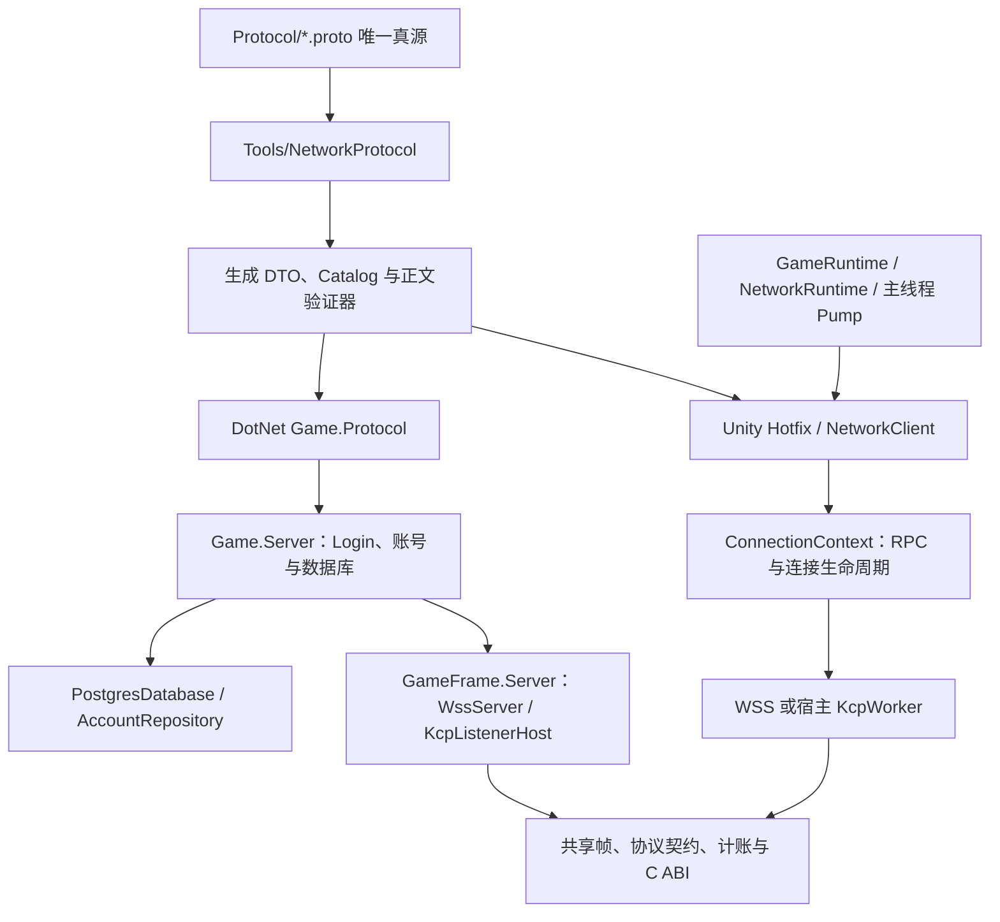

# 客户端与服务端网络全量审查（2026-10-12）

## 2026-10-13 修复状态

用户授权后已落实以下三项；后文保留 2026-10-12 的全量审查证据与当时结论，文件行号和哈希对应修复前版本，不代表当前仍有这些缺陷。本次按完整调用链复核变更，没有把针对性修复重复称为新一轮全量审查。

| 问题 | 实际修改与回归 |
| --- | --- |
| WSS 初始化阻塞传输/关闭 | Hello 后立即启动传输与控制 owner；每连接独立派发任务先完成 ConnectedAsync，再解码业务。应用 deadline 从就绪后开始，传输心跳始终运行。新增真实 WSS 慢初始化期间 Push/Pong/带原因关闭、成功后按序派发、初始化失败清理及 deadline 回归；慢初始化用例修复前失败。 |
| 未订阅 Push 跳过正文校验 | Pump 在查找订阅前校验正文，有订阅使用已验证正文解码，未订阅合法正文不创建 DTO。新增有/无订阅的非法根与超大数组、合法未订阅消息、校验次数与解码次数回归；非法未订阅用例修复前失败。 |
| KCP 选项超出 ABI 上限 | Snapshot 在 host 构造阶段逐字段拒绝越界连接数、握手数、授权数及原生内存额度。新增 8 项越界与 2 项合法边界回归；未扩大 C 容量。 |

验证证据：

- `DotNet/DotNet.sln` Release 编译：0 警告、0 错误。
- .NET Release 测试：NetworkServer 136/136、NetworkFramework 13/13、NetworkProtocol 182/182，合计 331/331，无跳过。使用独立临时 PostgreSQL 与现有 macOS universal 原生库，包含真实 WSS 和 UDP/DTLS；临时数据库已停止，未改动开发数据库。
- `Tools/NetworkProtocol check --artifacts` 通过；生成源码和协议指纹未变。
- Unity 6000.3.19f1 Editor 编译通过；NetworkMemoryPackTests/NetworkProtocolTests EditMode 144/144，NetworkLifecycleTests PlayMode 11/11。首次 PlayMode 在 TearDown 和 Unity Test Runner 出现空引用并中断；恢复验证前编辑器状态后单项复查及整组重跑通过，未削弱断言或修改运行器缓存。测试后恢复 Launch 场景、非播放状态和编辑器设置。
- 本次未重新构建/安装原生库，未执行 Player 脚本编译、IL2CPP、移动真机、Windows/Linux 平台实跑及生产容量/soak。性能与完整内存计账建议仍是后续测量任务，不因上述回归通过而视为完成。

使用契约已同步到 [客户端说明](Network.md)、[服务端框架说明](../DotNet/GameFrame.Server/README.md) 和 [设计](NetworkDesign.md)。

## 2026-10-12 审查原记录

本轮覆盖项目纳管的网络双方完整实现及相关协议、调用方、配置、测试、原生源码、生成工具和构建安装脚本。结论是：现有职责分层适合继续开发，需优先修复三处边界问题，再完善内存与性能验收。当时仅审查和验证，没有修改运行代码。

## 1. 覆盖范围与边界

先建立文件清单和调用关系，再逐文件连续阅读全文，对照 NetworkDesign、NetworkNativeDesign、Network、ServerAccounts 及错误/生命周期契约。最终清单 201 个文件、36,153 行；阅读范围无缺口，结束时源码 SHA-256 无漂移。12 份重复许可证逐份验证与已全文阅读的原件字节完全相同。逐文件清单见附录。

| 范围 | 文件 | 行数 | 核对内容 |
| --- | ---: | ---: | --- |
| 客户端网络框架 | 21 | 5,340 | 公共 API、Pump、连接状态、RPC、队列、WSS/KCP、计账和诊断 |
| 服务端四工程及配置 | 39 | 4,629 | Core、Server、Protocol、游戏账号业务、启动、数据库、部署配置 |
| C ABI、KCP、构建安装 | 26 | 5,330 | gfnet、仓库内 ikcp.c/h 全文、安全回归、依赖准备、平台构建和安装 |
| 协议与生成器 | 23 | 4,145 | 全部 proto、Roslyn/Proto 生成器、全部生成 C#、manifest、hash、向量 |
| 测试 | 29 | 5,677 | 三个 .NET 测试工程、Unity 网络 EditMode/PlayMode 与生命周期测试 |
| 集成、依赖与平台配置 | 52 | 8,053 | GameRuntime、Launch/GameEntry、程序集、MemoryPack 接入、CI、插件清单/导入配置/许可证 |
| 设计与契约 | 11 | 2,979 | 当前网络设计、使用、实施和历史审查、启动、错误、Scope 与数据库说明 |

这是项目网络代码审查，未扩大为其他 Unity 系统的全仓审查。MemoryPack、Npgsql、ASP.NET 和下载准备的 Mbed TLS/TF-PSA-Crypto 属于外部依赖：核对版本锁、接入、配置、构建来源和项目调用，但没有对它们的全部上游实现做独立源码安全审计。项目内纳管的第三方 KCP 已逐行覆盖。二进制使用哈希与平台配置核验，不能作为二进制反编译审计或真机运行证明。

WebGL WSS 和游戏世界业务按用户既定决定延后；不能把它们作为本轮必须补写的缺陷。

## 2. 调用关系与整体流程

服务端启动只准备服务依赖并验证数据库连通性、表结构，不查询/认证/创建玩家资料。注册、登录、恢复由客户端请求触发。GameFrame.Server 不依赖游戏 DTO 或 Npgsql；账号状态、密码哈希、SQL 在 Game.Server 中。客户端 Runtime 不引用 Hotfix，协议由热更层传入，双方编译相同的生成源码。无需重新拆出转发管理器或引入运行时反射注册。

同时核对了正常和失败路径：Hello/hash/票据绑定、认证前准入、响应前后的 epoch 检查、顶号和注销、取消/超时/迟到响应、可靠流的关闭排空、宿主停止、native owner 和缓冲所有权。此前修复的 epoch、过载收尾、关闭原因和日志注入仍在当前实现中，没有将历史文档中的已修复问题重复列为现存问题。

## 3. 优先修复的问题

### P1：WSS 的异步连接回调阻止传输与关闭流程启动

位置：`DotNet/GameFrame.Server/ServerConnection.cs:160`。

ServerHello 发出后先等待 `Session.ConnectedAsync`，随后才启动发送、接收、派发、心跳和 `CloseRequestedAsync`。框架允许应用在连接回调中做异步初始化；一旦等待外部 I/O，排队的 Push 无法及时发送，心跳尚未启动，外部 `RequestClose(reason)` 也没有运行中的关闭任务来处理。当前 LoginSession 的回调同步完成，所以现有账号联调不会自然触发这个问题；这是框架扩展生命周期缺陷。

本轮临时探针使用真实 ServerConnection 和可控 WebSocket，连接回调等待连接取消信号。请求 Close(9) 后等待 2,200ms：仍只有 ServerHello 一次发送，取消信号为 false，连接任务未结束。显式取消探针后清理完成，owned bytes 归零。

局部增加超时只能限制等待时长，仍会让业务初始化挡住传输控制。推荐调整整个连接启动流程：Hello 成功后立即启动传输和关闭 owner，将 ConnectedAsync 放在业务派发 owner 的第一阶段，完成后再派发业务消息。明确应用初始化就绪状态，应用 `CheckDeadline` 只在初始化就绪后执行；传输心跳和关闭不等待业务初始化。不能直接把全部任务提前，因为 LoginSession 的登录 deadline 在 ConnectedAsync 设置，初值 0 会被误判过期。回调仍需遵守连接 Cancellation，框架不能保证强制终止不响应取消的应用代码。

应补回归：慢回调期间 Push 可发送、外部带原因 Close 可推进并取消回调、初始化失败停止派发、关闭回调只执行一次、登录期限不因启动顺序改变而误触发。KCP 已把初始化放在独立派发任务中，可复用其职责划分思路，无需新建通用层。

### P2：未订阅的 Push 跳过正文 schema 校验

位置：`Unity/Assets/Scripts/Runtime/Network/NetworkClient.cs:101`、`:150`；`Connection/ConnectionContext.cs:899`、`:1480`；`Messaging/NetProtocolCatalog.cs:49`。

IO 校验头部的 opcode、路由类型、channel 和正文长度。正文验证在订阅回调调用 `route.Codec.Decode` 时发生；没有订阅时回调直接返回。因此一个已知 Push opcode 的非法 MemoryPack 正文，会因为当前没有监听者而被忽略。订阅状态改变了协议是否合法的判断，不符合设计要求的入站正文验证和消息故障边界。

这项结论来自完整调用链源码核对，本轮没有把它冒充 Unity 实跑复现。现有测试覆盖订阅回调抛错，尚未覆盖公共客户端收到“未订阅但正文非法”的情况。

推荐沿用已生成的字节验证器：在主线程 Pump 为每条实际交付的 Push 执行一次正文 shape 校验，然后才查找订阅者；有订阅时再反序列化和调用业务。给路由提供无需泛型反射的内部正文校验入口，并将 Decode 中的“校验”和“已验证正文解码”职责分清，避免同一正文扫描两遍。未订阅的合法 Push 仍可忽略，也无需创建 DTO。迟到 RPC 响应、已过期不可靠帧和终态清理按现有丢弃契约处理，不因此强制解码。

应补回归：未订阅的非法对象/数组/字符串正文同样产生 MessageFault 并 Fault；未订阅合法正文不反序列化；订阅释放与重建不改变协议判断；主线程和可靠到达顺序保持。

### P2：KCP 托管配置与 C ABI 的容量上限不一致

位置：`DotNet/GameFrame.Server/KcpServerOptions.cs:31`；`Native/Kcp/src/gfnet_listener.c:86`。

Snapshot 验证下限，但未验证 C listener 固定的上限：连接 64、握手 16、grant 256、native 总预算 256MiB。用户配置更大的值时，托管构造通过，到异步创建 listener 才得到笼统的 native 错误。

本轮直接验证四种配置：65 个连接、17 个握手、257 个 grant、256MiB+1。全部通过 Snapshot，全部在实际 ABI 2 的 `gfnet_listener_create` 返回 -1 且无 handle。这不是 OOM，也不是需要重试的失败。

推荐在 KcpServerOptions 的快照校验中按字段明确报错，并与 ABI 2 硬上限对应。局部修复足够，不应为方便修改一个配置就扩大未经容量验证的 C 上限。补上下界回归，保证错误在构造阶段出现；以后修改 ABI 容量时同时更新两侧限制和文档。

## 4. 优化与设计待完成项

### 内存预算应区分准入预约、缓冲容量与进程真实内存

`Transport/OwnedFrame.cs` 对实际数组容量以及每帧 512 字节记录 allowance 计账，Pending 也有 512 字节预约；这已经覆盖关键在途缓冲与扩容峰值。但 deadline 容器、集合保留容量、宿主/连接固定对象、任务和外部库内存并不是逐项实际测量。OwnedBytes 是准入预约指标，不能据此宣称完整托管堆或进程 RSS 已受同一个上限约束。

推荐先列清固定容器和持续保留容量的归属，补有界容量预约及可测的诊断，不将所有 CLR 内部对象伪装成“精确计账”。现有条数、帧长和 native 上限继续保留。`MaxIdlePoolBytes` 目前配置可传、实际闲置池为 0，当前实施文档已明确；应在公开 API 说明中直接标注这一点，后续启用池时再兑现其行为。

### 固定帧路径仍有每包托管分配，与预热后验收目标有差距

`FrameMemoryBudget.Allocate` 每次创建 byte[] 和 lease，发送/接收记录与 writer 也会分配。可靠发送按路由最大正文容量分配，释放清零整个容量，小消息也支付最大容量成本。当前做法容易证明所有权和上限，正确性优先的选择合理；但它没有达到 NetworkDesign 第 19 节“固定帧/控制包/池内传输路径预热后无逐包托管分配”的目标。

推荐先测实际 Unity/IL2CPP 的 bytes/s、GC、清零时间和峰值，再做有界分档缓冲及可复用帧记录。若发送最大容量浪费明显，可让生成器提供编码长度计算，或使用受路由上限约束的增长 writer；比较多一次遍历与扩容复制成本后选择。池的闲置容量、借出容量和扩容峰值都必须计账，不能直接换成无归属的 ArrayPool.Shared。敏感帧的清零语义要保留。当前没有压测证据，不能把这些成本称为已证实的性能瓶颈。

### 补能指导性能取舍的指标，再考虑锁和调度改造

当前客户端已有 Ping RTT、帧/正文流量、队列条数、RPC 超时/取消、native 分配和 KCP 窗口/重传等快照；缺少设计中的 RPC 到达与主线程排队耗时、Pump 外编码耗时、完整主线程总成本、分配量、最长处理器耗时和 worker 轮转延迟等。服务端也尚无完整的容量与尾延迟报告。

优先补这些指标并按真实负载测量。`gfnet_get_stats` 遍历待发/在途 KCP segment，客户端驱动频繁采样；如果测量显示诊断开销明显，可降低统计采样频率，同时保持 tick/deadline 频率。AccountSessions 登录时持全局锁并清理过期记录，目前有界、默认 local 1024 账号会话；先测锁等待与耗时，再决定是否分批清理或拆分索引，不凭当前源码直接引入 Actor、线程池或分片。

### P3：构建指纹可拆分运行时输入与验证工具记录

`Native/Kcp/build/build.py:24` 的 sources 同时包含生产源码、测试、安装脚本和验证脚本；安装器要求整份 sources 与当前仓库完全一致。因此只修改测试或 installer，也会让旧的各平台库不能再安装。当前行为严格且可追溯，不是运行时安全缺陷，但增加后续维护成本。

建议分为“影响二进制的源码/配置/工具链输入”和“验证工具及结果”，两者都记录，安装阻断由运行时输入、ABI 和产物哈希决定。CMake、编译配置、依赖锁、KCP 修改及影响产物的构建逻辑仍需严格校验。无需增加自动覆盖、回滚或静默兼容机制。

### 文档应让当前契约与历史证据更容易区分

NetworkImplementation、NetworkServerReview 保存多轮演进和已修复问题；目前有历史标记，但读前段容易误以为旧缺口仍存在。推荐维护短的当前状态/待验收列表，将详细历史证据单独保留。本报告只列当前发现，不把 WSS 已实现的 CloseOutput/对端关闭确认或已修复的旧状态竞态再次报错。

## 5. 本轮验证证据

| 验证 | 本轮结果 | 证明范围 |
| --- | --- | --- |
| `dotnet build DotNet/DotNet.sln -c Release --no-restore` | 0 警告、0 错误 | 四个 .NET 工程编译 |
| NetworkServer.Tests / Release | 120/120，通过，0 跳过 | 启用独立 PostgreSQL 18 临时 cluster 和 macOS native 库，覆盖真实 WSS、UDP、账号与竞态 |
| NetworkFramework.Tests / Release | 10/10，通过，0 跳过 | 无游戏 DTO/账号依赖的框架边界 |
| NetworkProtocol.Tests / Release | 181/181，通过，0 跳过 | schema、编码、生成器和漂移检测 |
| `NetworkProtocol check --artifacts` | exit 0 | 当前生成 C#、manifest、hash 和开发向量一致 |
| macOS universal Release 的 ctest | 1/1，通过 | 现有 gfnet native regression 的本机执行 |
| `verify_fastack.py` | ACK 16/16、scheduler 4/4 | 普通/回绕时钟与断言/NDEBUG 对照 |
| `verify_allocation_safety.py` | 75 分配用例通过，ASan/UBSan 无错误 | KCP 源码锁、分配失败、ACK 和所有者释放；不是整套 mbedTLS sanitizer 审计 |
| WSS 慢回调临时探针 | 确认关闭停滞；显式取消后内存归零 | P1 生命周期问题，使用受控 WebSocket，不是 Unity 客户端平台运行 |
| KCP 上限临时探针 | 4/4 托管接受而实际 native 拒绝 | P2 配置差异 |
| 5 套已安装原生插件 | 二进制哈希和纳管 source hashes 与清单一致 | macOS、Windows、Android、iOS device/simulator 的产物来源 |

协议测试中打印的 Obsolete.cs/生成差异是测试主动构造的漂移拒绝场景；最终真实 `check --artifacts` 通过。

本轮未执行 Unity Editor 编译、EditMode/PlayMode 实跑、Player 脚本编译、IL2CPP 打包、设备运行、Windows/Linux 服务端运行或容量/24h soak。源码审查和 .NET 回归不能替代这些平台证据；既有构建清单中的历史通过也没有算作本轮新实跑。原生分配安全脚本有 KCP 上游日志函数 vsprintf 的弃用警告，未导致测试或 sanitizer 失败，当前未据此认定远程输入缺陷。

临时 PostgreSQL 使用随机端口，与用户开发库隔离，验证结束已停止；没有停止 Rider 服务、替换插件、修改证书或 Unity 设置。

## 6. 推荐执行顺序

1. 调整 WSS 初始化与传输/关闭的职责，补慢回调回归。
2. 补主线程 Push 正文统一校验，修改生成/codec 接口时同步双端编译与向量检查。
3. 补 KCP 配置上限，保持 ABI 2 的既有容量边界。
4. 补固定容量预约和性能指标，取得 Unity/IL2CPP 的分配与延迟数据后再决定池化、长度计算、采样及锁优化。
5. 分离构建输入指纹和验证记录，整理当前文档状态，继续已有平台验收。

这些改进沿用当前分层与所有权机制；没有理由回到反射入口、把数据库移入框架，或增加隐式重连、失败重试和业务兜底。

## 附录：逐文件覆盖清单

路径相对仓库根目录。全部连续行范围均已读；重复许可证采用全文原件加逐份字节一致验证。清单中每份文件已核对 SHA-256，按路径排序后的“路径 + SHA-256”集合摘要为 `18dddf74fed6cae28f408dc399728ad63b0ee1a875f306d23d8a51786b37b331`。本报告是本轮新增交付物，不计入被审查文件数。

| 文件 | 全文行数 | 覆盖 |
| --- | ---: | --- |
| `.github/workflows/network.yml` | 127 | 1–127 全文 |
| `.gitignore` | 43 | 1–43 全文 |
| `Docs/ErrorContract.md` | 53 | 1–53 全文 |
| `Docs/Launch.md` | 155 | 1–155 全文 |
| `Docs/MemoryPack.md` | 46 | 1–46 全文 |
| `Docs/Network.md` | 75 | 1–75 全文 |
| `Docs/NetworkDesign.md` | 1034 | 1–1034 全文 |
| `Docs/NetworkImplementation.md` | 400 | 1–400 全文 |
| `Docs/NetworkNativeDesign.md` | 247 | 1–247 全文 |
| `Docs/NetworkReview.md` | 180 | 1–180 全文 |
| `Docs/NetworkServerReview.md` | 646 | 1–646 全文 |
| `Docs/Scope.md` | 33 | 1–33 全文 |
| `Docs/ServerAccounts.md` | 110 | 1–110 全文 |
| `DotNet/Directory.Build.props` | 9 | 1–9 全文 |
| `DotNet/DotNet.sln` | 73 | 1–73 全文 |
| `DotNet/Game.Protocol/Game.Protocol.csproj` | 7 | 1–7 全文 |
| `DotNet/Game.Protocol/packages.lock.json` | 30 | 1–30 全文 |
| `DotNet/Game.Server/AssemblyInfo.cs` | 3 | 1–3 全文 |
| `DotNet/Game.Server/Database/001_accounts.sql` | 15 | 1–15 全文 |
| `DotNet/Game.Server/Database/PostgresDatabase.cs` | 31 | 1–31 全文 |
| `DotNet/Game.Server/Game.Server.csproj` | 13 | 1–13 全文 |
| `DotNet/Game.Server/LobbyApplication.cs` | 43 | 1–43 全文 |
| `DotNet/Game.Server/LocalEnvironment.cs` | 27 | 1–27 全文 |
| `DotNet/Game.Server/LocalKcpService.cs` | 103 | 1–103 全文 |
| `DotNet/Game.Server/LocalWssService.cs` | 75 | 1–75 全文 |
| `DotNet/Game.Server/Login/AccountService.cs` | 94 | 1–94 全文 |
| `DotNet/Game.Server/Login/AccountSessions.cs` | 363 | 1–363 全文 |
| `DotNet/Game.Server/Login/IAccountRepository.cs` | 20 | 1–20 全文 |
| `DotNet/Game.Server/Login/LoginHandlers.cs` | 183 | 1–183 全文 |
| `DotNet/Game.Server/Login/LoginOptions.cs` | 19 | 1–19 全文 |
| `DotNet/Game.Server/Login/LoginSession.cs` | 129 | 1–129 全文 |
| `DotNet/Game.Server/Login/PasswordHasher.cs` | 32 | 1–32 全文 |
| `DotNet/Game.Server/Login/PostgresAccountRepository.cs` | 56 | 1–56 全文 |
| `DotNet/Game.Server/Program.cs` | 38 | 1–38 全文 |
| `DotNet/Game.Server/Properties/launchSettings.json` | 15 | 1–15 全文 |
| `DotNet/Game.Server/packages.lock.json` | 48 | 1–48 全文 |
| `DotNet/GameFrame.Network.Core/AssemblyInfo.cs` | 7 | 1–7 全文 |
| `DotNet/GameFrame.Network.Core/GameFrame.Network.Core.csproj` | 12 | 1–12 全文 |
| `DotNet/GameFrame.Network.Core/packages.lock.json` | 6 | 1–6 全文 |
| `DotNet/GameFrame.Server/AssemblyInfo.cs` | 4 | 1–4 全文 |
| `DotNet/GameFrame.Server/GameFrame.Server.csproj` | 6 | 1–6 全文 |
| `DotNet/GameFrame.Server/KcpListenerHost.cs` | 1303 | 1–1303 全文 |
| `DotNet/GameFrame.Server/KcpServerOptions.cs` | 43 | 1–43 全文 |
| `DotNet/GameFrame.Server/README.md` | 72 | 1–72 全文 |
| `DotNet/GameFrame.Server/ServerApplication.cs` | 451 | 1–451 全文 |
| `DotNet/GameFrame.Server/ServerConnection.cs` | 873 | 1–873 全文 |
| `DotNet/GameFrame.Server/WssServer.cs` | 211 | 1–211 全文 |
| `DotNet/GameFrame.Server/WssServerOptions.cs` | 47 | 1–47 全文 |
| `DotNet/GameFrame.Server/packages.lock.json` | 10 | 1–10 全文 |
| `DotNet/README.md` | 133 | 1–133 全文 |
| `DotNet/compose.yaml` | 19 | 1–19 全文 |
| `DotNet/global.json` | 6 | 1–6 全文 |
| `Native/Kcp/ABI.md` | 64 | 1–64 全文 |
| `Native/Kcp/CMakeLists.txt` | 62 | 1–62 全文 |
| `Native/Kcp/README.md` | 104 | 1–104 全文 |
| `Native/Kcp/build/build.py` | 191 | 1–191 全文 |
| `Native/Kcp/build/install.py` | 86 | 1–86 全文 |
| `Native/Kcp/build/prepare_kcp.py` | 59 | 1–59 全文 |
| `Native/Kcp/build/prepare_mbedtls.py` | 126 | 1–126 全文 |
| `Native/Kcp/build/verify_windows.py` | 74 | 1–74 全文 |
| `Native/Kcp/build/windows-llvm-mingw.cmake` | 17 | 1–17 全文 |
| `Native/Kcp/config/crypto_config.h` | 25 | 1–25 全文 |
| `Native/Kcp/config/mbedtls_config.h` | 15 | 1–15 全文 |
| `Native/Kcp/config/threading_alt.h` | 6 | 1–6 全文 |
| `Native/Kcp/include/gfnet.h` | 95 | 1–95 全文 |
| `Native/Kcp/src/gfnet_connection.c` | 599 | 1–599 全文 |
| `Native/Kcp/src/gfnet_internal.h` | 97 | 1–97 全文 |
| `Native/Kcp/src/gfnet_listener.c` | 408 | 1–408 全文 |
| `Native/Kcp/src/gfnet_memory.c` | 237 | 1–237 全文 |
| `Native/Kcp/tests/allocation_safety.c` | 241 | 1–241 全文 |
| `Native/Kcp/tests/fastack_regression.cpp` | 201 | 1–201 全文 |
| `Native/Kcp/tests/gfnet_regression.c` | 538 | 1–538 全文 |
| `Native/Kcp/tests/verify_allocation_safety.py` | 97 | 1–97 全文 |
| `Native/Kcp/tests/verify_fastack.py` | 76 | 1–76 全文 |
| `Native/Kcp/third_party/kcp/LICENSE` | 21 | 1–21 全文 |
| `Native/Kcp/third_party/kcp/ikcp.c` | 1422 | 1–1422 全文 |
| `Native/Kcp/third_party/kcp/ikcp.h` | 452 | 1–452 全文 |
| `Native/Kcp/third_party/mbedtls.lock.json` | 17 | 1–17 全文 |
| `Protocol/Common/ResultProto.proto` | 24 | 1–24 全文 |
| `Protocol/Common/net_options.proto` | 34 | 1–34 全文 |
| `Protocol/Diagnostics/DiagnosticsProto.proto` | 15 | 1–15 全文 |
| `Protocol/Diagnostics/DiagnosticsService.proto` | 15 | 1–15 全文 |
| `Protocol/GameFrame.Protocol.projitems` | 6 | 1–6 全文 |
| `Protocol/Generated/golden-vectors.json` | 59 | 1–59 全文 |
| `Protocol/Generated/protocol.manifest.json` | 841 | 1–841 全文 |
| `Protocol/Generated/protocol.sha256` | 1 | 1–1 全文 |
| `Protocol/README.md` | 109 | 1–109 全文 |
| `Protocol/Session/SessionProto.proto` | 64 | 1–64 全文 |
| `Protocol/Session/SessionService.proto` | 48 | 1–48 全文 |
| `Protocol/World/WorldProto.proto` | 87 | 1–87 全文 |
| `Protocol/World/WorldService.proto` | 75 | 1–75 全文 |
| `Tools/NetworkFramework.Tests/FrameworkBoundaryTests.cs` | 351 | 1–351 全文 |
| `Tools/NetworkFramework.Tests/NetworkFramework.Tests.csproj` | 16 | 1–16 全文 |
| `Tools/NetworkFramework.Tests/packages.lock.json` | 78 | 1–78 全文 |
| `Tools/NetworkProtocol.Tests/GeneratorTests.cs` | 104 | 1–104 全文 |
| `Tools/NetworkProtocol.Tests/NetworkOptionsTests.cs` | 22 | 1–22 全文 |
| `Tools/NetworkProtocol.Tests/NetworkProtocol.Tests.csproj` | 28 | 1–28 全文 |
| `Tools/NetworkProtocol.Tests/ProtoGenerationTests.cs` | 228 | 1–228 全文 |
| `Tools/NetworkProtocol.Tests/packages.lock.json` | 144 | 1–144 全文 |
| `Tools/NetworkProtocol/AssemblyInfo.cs` | 3 | 1–3 全文 |
| `Tools/NetworkProtocol/MemoryPackProtocolGenerator.cs` | 677 | 1–677 全文 |
| `Tools/NetworkProtocol/NetworkProtocol.csproj` | 20 | 1–20 全文 |
| `Tools/NetworkProtocol/Program.cs` | 82 | 1–82 全文 |
| `Tools/NetworkProtocol/ProtoProtocolGenerator.cs` | 462 | 1–462 全文 |
| `Tools/NetworkProtocol/ProtocolRouteDefinition.cs` | 7 | 1–7 全文 |
| `Tools/NetworkProtocol/ProtocolSamples.cs` | 85 | 1–85 全文 |
| `Tools/NetworkProtocol/packages.lock.json` | 59 | 1–59 全文 |
| `Tools/NetworkServer.Tests/AccountLifecycleTests.cs` | 301 | 1–301 全文 |
| `Tools/NetworkServer.Tests/ConnectionRaceTests.cs` | 499 | 1–499 全文 |
| `Tools/NetworkServer.Tests/KcpLoopbackTests.cs` | 794 | 1–794 全文 |
| `Tools/NetworkServer.Tests/KcpSourceBudgetTests.cs` | 46 | 1–46 全文 |
| `Tools/NetworkServer.Tests/NetworkServer.Tests.csproj` | 24 | 1–24 全文 |
| `Tools/NetworkServer.Tests/PostgresAccountTests.cs` | 145 | 1–145 全文 |
| `Tools/NetworkServer.Tests/PostgresTestDatabase.cs` | 69 | 1–69 全文 |
| `Tools/NetworkServer.Tests/ServerCloseTests.cs` | 113 | 1–113 全文 |
| `Tools/NetworkServer.Tests/ServerHeartbeatTests.cs` | 210 | 1–210 全文 |
| `Tools/NetworkServer.Tests/TestAccountRepository.cs` | 59 | 1–59 全文 |
| `Tools/NetworkServer.Tests/WssLifecycleTests.cs` | 238 | 1–238 全文 |
| `Tools/NetworkServer.Tests/WssServerTests.cs` | 672 | 1–672 全文 |
| `Tools/NetworkServer.Tests/packages.lock.json` | 133 | 1–133 全文 |
| `Tools/README.md` | 59 | 1–59 全文 |
| `Tools/global.json` | 6 | 1–6 全文 |
| `Tools/postgres.py` | 71 | 1–71 全文 |
| `Unity/Assets/NuGet.config` | 18 | 1–18 全文 |
| `Unity/Assets/Packages/MemoryPack.Core.1.21.4/lib/netstandard2.1/MemoryPack.Core.dll.meta` | 29 | 1–29 全文 |
| `Unity/Assets/Packages/MemoryPack.Generator.1.21.4/analyzers/dotnet/cs/MemoryPack.Generator.dll.meta` | 52 | 1–52 全文 |
| `Unity/Assets/Plugins/GameFrame/Native/Kcp/Android/arm64-v8a/artifact.json` | 8 | 1–8 全文 |
| `Unity/Assets/Plugins/GameFrame/Native/Kcp/Android/arm64-v8a/build-manifest.json` | 111 | 1–111 全文 |
| `Unity/Assets/Plugins/GameFrame/Native/Kcp/Android/arm64-v8a/libgameframe_kcp.so.meta` | 22 | 1–22 全文 |
| `Unity/Assets/Plugins/GameFrame/Native/Kcp/Android/arm64-v8a/licenses/KCP-MIT.txt` | 21 | 1–21 全文 |
| `Unity/Assets/Plugins/GameFrame/Native/Kcp/Android/arm64-v8a/licenses/TF-PSA-Crypto-LICENSE.txt` | 552 | 1–552 全文 |
| `Unity/Assets/Plugins/GameFrame/Native/Kcp/Android/arm64-v8a/licenses/mbedTLS-LICENSE.txt` | 553 | 1–553 全文 |
| `Unity/Assets/Plugins/GameFrame/Native/Kcp/Windows/x86_64/artifact.json` | 8 | 1–8 全文 |
| `Unity/Assets/Plugins/GameFrame/Native/Kcp/Windows/x86_64/build-manifest.json` | 153 | 1–153 全文 |
| `Unity/Assets/Plugins/GameFrame/Native/Kcp/Windows/x86_64/gameframe_kcp.dll.meta` | 25 | 1–25 全文 |
| `Unity/Assets/Plugins/GameFrame/Native/Kcp/Windows/x86_64/licenses/KCP-MIT.txt` | 21 | 与已读原件字节一致 |
| `Unity/Assets/Plugins/GameFrame/Native/Kcp/Windows/x86_64/licenses/TF-PSA-Crypto-LICENSE.txt` | 552 | 与已读原件字节一致 |
| `Unity/Assets/Plugins/GameFrame/Native/Kcp/Windows/x86_64/licenses/mbedTLS-LICENSE.txt` | 553 | 与已读原件字节一致 |
| `Unity/Assets/Plugins/GameFrame/Native/Kcp/iOS/artifact.json` | 8 | 1–8 全文 |
| `Unity/Assets/Plugins/GameFrame/Native/Kcp/iOS/build-manifest.json` | 113 | 1–113 全文 |
| `Unity/Assets/Plugins/GameFrame/Native/Kcp/iOS/libgameframe_kcp.a.meta` | 22 | 1–22 全文 |
| `Unity/Assets/Plugins/GameFrame/Native/Kcp/iOS/licenses/KCP-MIT.txt` | 21 | 与已读原件字节一致 |
| `Unity/Assets/Plugins/GameFrame/Native/Kcp/iOS/licenses/TF-PSA-Crypto-LICENSE.txt` | 552 | 与已读原件字节一致 |
| `Unity/Assets/Plugins/GameFrame/Native/Kcp/iOS/licenses/mbedTLS-LICENSE.txt` | 553 | 与已读原件字节一致 |
| `Unity/Assets/Plugins/GameFrame/Native/Kcp/iOSSimulator/arm64/artifact.json` | 8 | 1–8 全文 |
| `Unity/Assets/Plugins/GameFrame/Native/Kcp/iOSSimulator/arm64/build-manifest.json` | 113 | 1–113 全文 |
| `Unity/Assets/Plugins/GameFrame/Native/Kcp/iOSSimulator/arm64/libgameframe_kcp.a.meta` | 19 | 1–19 全文 |
| `Unity/Assets/Plugins/GameFrame/Native/Kcp/iOSSimulator/arm64/licenses/KCP-MIT.txt` | 21 | 与已读原件字节一致 |
| `Unity/Assets/Plugins/GameFrame/Native/Kcp/iOSSimulator/arm64/licenses/TF-PSA-Crypto-LICENSE.txt` | 552 | 与已读原件字节一致 |
| `Unity/Assets/Plugins/GameFrame/Native/Kcp/iOSSimulator/arm64/licenses/mbedTLS-LICENSE.txt` | 553 | 与已读原件字节一致 |
| `Unity/Assets/Plugins/GameFrame/Native/Kcp/macOS/artifact.json` | 8 | 1–8 全文 |
| `Unity/Assets/Plugins/GameFrame/Native/Kcp/macOS/build-manifest.json` | 112 | 1–112 全文 |
| `Unity/Assets/Plugins/GameFrame/Native/Kcp/macOS/libgameframe_kcp.dylib.meta` | 25 | 1–25 全文 |
| `Unity/Assets/Plugins/GameFrame/Native/Kcp/macOS/licenses/KCP-MIT.txt` | 21 | 与已读原件字节一致 |
| `Unity/Assets/Plugins/GameFrame/Native/Kcp/macOS/licenses/TF-PSA-Crypto-LICENSE.txt` | 552 | 与已读原件字节一致 |
| `Unity/Assets/Plugins/GameFrame/Native/Kcp/macOS/licenses/mbedTLS-LICENSE.txt` | 553 | 与已读原件字节一致 |
| `Unity/Assets/Scripts/AOT/Game.AOT.asmdef` | 20 | 1–20 全文 |
| `Unity/Assets/Scripts/AOT/GlobalConfig.cs` | 99 | 1–99 全文 |
| `Unity/Assets/Scripts/AOT/Launch.cs` | 92 | 1–92 全文 |
| `Unity/Assets/Scripts/Hotfix/Game.Hotfix.asmdef` | 22 | 1–22 全文 |
| `Unity/Assets/Scripts/Hotfix/GameEntry.cs` | 84 | 1–84 全文 |
| `Unity/Assets/Scripts/Hotfix/Network/Generated/GameNetMessages.cs` | 379 | 1–379 全文 |
| `Unity/Assets/Scripts/Hotfix/Network/Generated/GameNetProtocol.cs` | 993 | 1–993 全文 |
| `Unity/Assets/Scripts/Runtime/AssemblyInfo.cs` | 5 | 1–5 全文 |
| `Unity/Assets/Scripts/Runtime/GameFrame.Runtime.asmdef` | 21 | 1–21 全文 |
| `Unity/Assets/Scripts/Runtime/Lifecycle/GameRuntime.cs` | 208 | 1–208 全文 |
| `Unity/Assets/Scripts/Runtime/Lifecycle/GameRuntimeConfig.cs` | 32 | 1–32 全文 |
| `Unity/Assets/Scripts/Runtime/Network/Connection/ConnectionContext.cs` | 1675 | 1–1675 全文 |
| `Unity/Assets/Scripts/Runtime/Network/Connection/PendingDeadlineHeap.cs` | 113 | 1–113 全文 |
| `Unity/Assets/Scripts/Runtime/Network/Messaging/NetProtocolCatalog.cs` | 220 | 1–220 全文 |
| `Unity/Assets/Scripts/Runtime/Network/NetworkClient.cs` | 339 | 1–339 全文 |
| `Unity/Assets/Scripts/Runtime/Network/NetworkClock.cs` | 16 | 1–16 全文 |
| `Unity/Assets/Scripts/Runtime/Network/NetworkConnectOptions.cs` | 114 | 1–114 全文 |
| `Unity/Assets/Scripts/Runtime/Network/NetworkDiagnostics.cs` | 163 | 1–163 全文 |
| `Unity/Assets/Scripts/Runtime/Network/NetworkException.cs` | 55 | 1–55 全文 |
| `Unity/Assets/Scripts/Runtime/Network/NetworkOptions.cs` | 104 | 1–104 全文 |
| `Unity/Assets/Scripts/Runtime/Network/NetworkRuntime.cs` | 334 | 1–334 全文 |
| `Unity/Assets/Scripts/Runtime/Network/Protocol/ControlCodec.cs` | 356 | 1–356 全文 |
| `Unity/Assets/Scripts/Runtime/Network/Protocol/FrameCodec.cs` | 193 | 1–193 全文 |
| `Unity/Assets/Scripts/Runtime/Network/ProtocolContracts/NetProtocolContracts.cs` | 83 | 1–83 全文 |
| `Unity/Assets/Scripts/Runtime/Network/ProtocolContracts/NetWireReader.cs` | 151 | 1–151 全文 |
| `Unity/Assets/Scripts/Runtime/Network/Transport/IFrameTransport.cs` | 21 | 1–21 全文 |
| `Unity/Assets/Scripts/Runtime/Network/Transport/Kcp/KcpNative.cs` | 220 | 1–220 全文 |
| `Unity/Assets/Scripts/Runtime/Network/Transport/Kcp/KcpTransport.cs` | 697 | 1–697 全文 |
| `Unity/Assets/Scripts/Runtime/Network/Transport/Kcp/KcpWorker.cs` | 156 | 1–156 全文 |
| `Unity/Assets/Scripts/Runtime/Network/Transport/OwnedFrame.cs` | 183 | 1–183 全文 |
| `Unity/Assets/Scripts/Runtime/Network/Transport/WebSocketFrameTransport.cs` | 95 | 1–95 全文 |
| `Unity/Assets/Scripts/Runtime/Network/Transport/WebSocketTransport.cs` | 52 | 1–52 全文 |
| `Unity/Assets/Scripts/Tests/EditMode/GameFrame.Tests.EditMode.asmdef` | 30 | 1–30 全文 |
| `Unity/Assets/Scripts/Tests/EditMode/Network/NetworkBufferTests.cs` | 56 | 1–56 全文 |
| `Unity/Assets/Scripts/Tests/EditMode/Network/NetworkMemoryPackTests.cs` | 277 | 1–277 全文 |
| `Unity/Assets/Scripts/Tests/EditMode/Network/NetworkProtocolTests.cs` | 380 | 1–380 全文 |
| `Unity/Assets/Scripts/Tests/PlayMode/GameFrame.Tests.PlayMode.asmdef` | 30 | 1–30 全文 |
| `Unity/Assets/Scripts/Tests/PlayMode/GameRuntimeTests.cs` | 260 | 1–260 全文 |
| `Unity/Assets/Scripts/Tests/PlayMode/NetworkKcpLoopbackTests.cs` | 84 | 1–84 全文 |
| `Unity/Assets/Scripts/Tests/PlayMode/NetworkLifecycleTests.cs` | 286 | 1–286 全文 |
| `Unity/Assets/packages.config` | 7 | 1–7 全文 |
| `Unity/Packages/manifest.json` | 74 | 1–74 全文 |
| `Unity/Packages/packages-lock.json` | 567 | 1–567 全文 |
| `Unity/ProjectSettings/HybridCLRSettings.asset` | 30 | 1–30 全文 |
| `Unity/ProjectSettings/ProjectVersion.txt` | 2 | 1–2 全文 |
