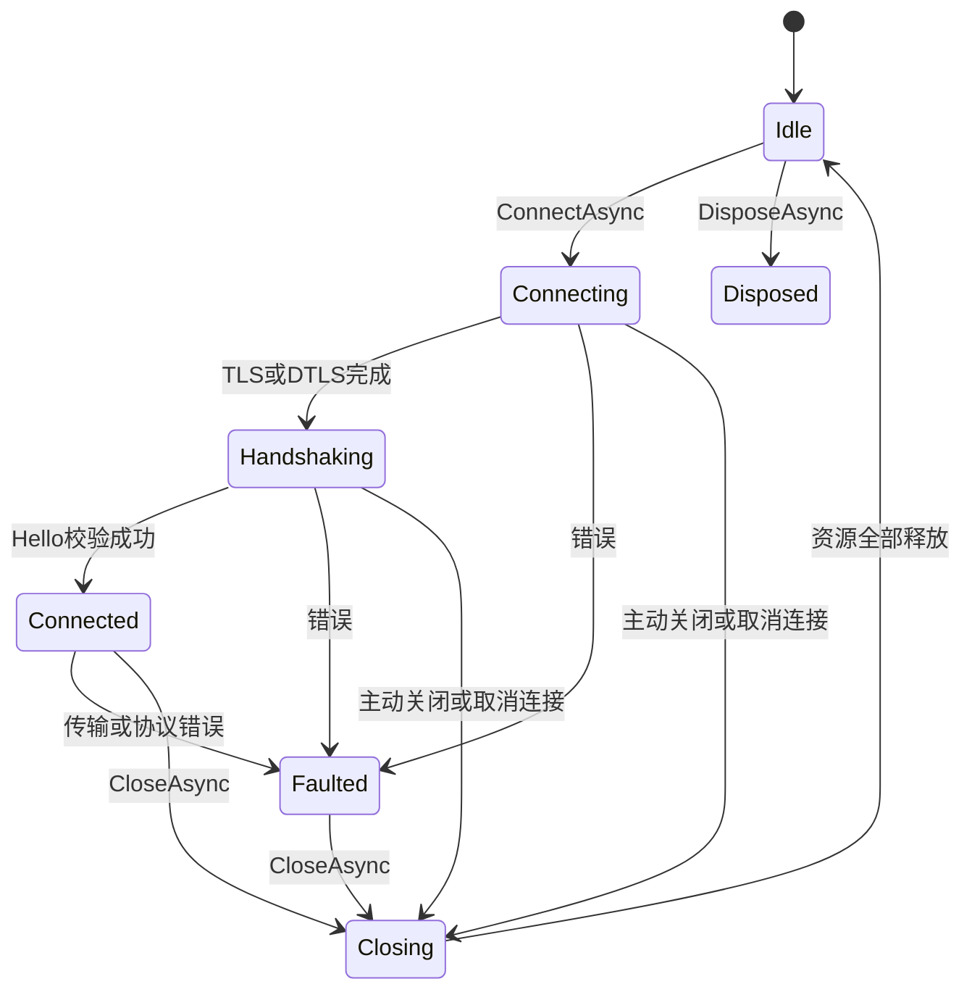
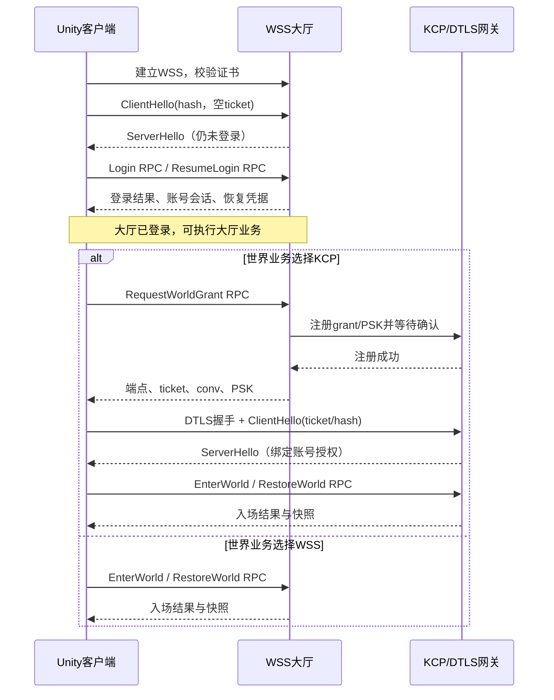

# GameFrame 商业网络模块设计

> 状态：分阶段实施中，2026-10-11。本文定义第一版实现与验收契约；已完成项与验证范围见 [实施记录](NetworkImplementation.md)，不代表完整模块已经通过正式包验证。
> 技术基线：WebSocket/WSS、MemoryPack 1.21.4、原版 C KCP；服务端已确定为 C#/.NET 10。
> 会话入口：WSS 建连与协议握手 → 登录 RPC → 大厅会话；战斗按配置复用 WSS，或通过大厅申请授权后建立 KCP/DTLS。

## 1. 目标与范围

建立可用于大厅、房间、即时战斗和大型在线游戏客户端的网络模块，交付内容包括 Unity Runtime、Hotfix 接入示例、协议工具、原生插件、.NET 联调服务和自动化验证。实现优先保证协议正确、资源可回收、失败可观察、内存有上限，再依据测量优化分配和吞吐。

第一版必须提供：

- WSS 可靠有序消息；原版 C KCP over UDP 的可靠有序消息，以及同一加密 UDP 会话上的不可靠消息。
- MemoryPack 强类型业务协议、强类型 RPC/推送、取消、超时、心跳、连接代际隔离。
- 明确的字节数与条数限额、背压、帧派发预算、可观测指标、可重复网络故障测试。
- Windows、macOS、Android、iOS 的原生插件与 IL2CPP 验证；WebGL 只提供浏览器 WSS。
- 服务端鉴权、协议一致性校验、加密、会话绑定、限流与幂等的接口契约。

不在通用 Runtime 内实现角色、房间、AOI、预测回滚、经济系统或业务恢复。文档会定义这些功能如何接入，但不会用一个通用 `NetworkManager` 代替游戏服务端架构。资源下载、热更包、录像和大型快照文件走 HTTPS/YooAsset，不通过实时消息通道传输。

用户已确定客户端与服务端同步更新协议。第一版要求协议完全一致，不建设旧消息兼容、双协议网关或自动回退。连接失败、RPC 失败均不自动重试；KCP 重传和 DTLS 握手重传属于选定传输协议自身行为，不等于重发业务操作。

第一版使用固定限额、单一资源所有者和串行状态提交；不新增通用调度框架、动态调参、自定义拥塞算法或分布式事务。服务端按实测容量配置分片数量，客户端不承担服务端扩容逻辑。

## 2. 已核对的项目现状

| 项目 | 当前事实 | 本设计的后续工作 |
| --- | --- | --- |
| GameFrame 网络 | 尚无游戏网络模块；`GameMediaNetwork` 是媒体网络策略工具 | 新建 `GameFrame.Network` 命名空间，放入已有 `GameFrame.Runtime` 程序集 |
| MemoryPack | 已安装 1.21.4；Editor 和 StandaloneOSX Player 脚本编译通过 | 加入正式 DTO、协议生成检查、跨端与 HybridCLR 实机测试 |
| KCP | `Unity/Assets/Plugins/GameFrame/Kcp` 下已有 `ikcp.c`、`ikcp.h`、MIT LICENSE；已将 PR #467 的一行 ACK 聚合修复直接合入 `ikcp.c` | 保留文件路径和 GUID，新增固定 ABI 包装、UDP 集成及构建产物 |
| KCP 版本 | 上游基线为 `b1a7a2101dcbb96017681a500d6b82bbe5a88766`，包含 `IKCPOPS`/`ikcp_setcc`；本地增加已记录的 #467 修复 | 锁定基线与本地源码 hash；不得直接按旧版 C# KCP 包的内部结构接入 |
| 生命周期 | `GameRuntime` 尚不管理网络；GameEntry 当前启动本地五子棋 | 增加可选网络宿主，不让离线业务被迫连接 |
| 服务端 | 已有 `DotNet/DotNet.sln`、`DotNet/DotNet.csproj`，与 `Unity/` 同级；目标 `net10.0`，当前为仅输出 Hello World 的控制台项目 | 在现有工程中实现服务端与本地联调模式，共用 C# 协议源码 |

MemoryPack 安装与当前验证边界见 [MemoryPack.md](MemoryPack.md)。启动、资源所有权与失败处理以 [Launch.md](Launch.md)、[Scope.md](Scope.md)、[ErrorContract.md](ErrorContract.md) 为基础；本文补充网络模块的固定策略。

### 2.1 `unitygame` 参考结论

参考工程位于相邻目录 `../../unitygame`。以下只复用设计经验，不直接复制其业务单例与旧协议。

| 参考文件/设计 | 保留的经验 | 本次必须调整 |
| --- | --- | --- |
| `AOT/Network/NetClient.cs` | 单发送循环、单接收循环、后台 IO | 所有队列同时限制容量和条数；连接上下文独立；退出必须等待 IO 实际结束 |
| `PacketCodec.cs` | 集中编解码、池化缓冲 | 新帧协议；每个 WebSocket 分片进入缓冲前检查上限，禁止先扩容后检查 |
| `RpcClient.cs` | 请求与响应关联 | 取消贯穿 pending 生命周期；统一 deadline 调度；消除每个成功 RPC 留下的超时任务 |
| `NetDispatcher.cs`、`NetHeartbeat.cs` | Unity 主线程业务派发、应用心跳 | 不使用 `Time.time`；心跳在 IO 层处理，不被主线程积压误判 |
| `NetMessageService.cs` | `NetRpc<TRequest,TResponse>`、`NetPush<T>` 类型化路由 | 生成协议目录和校验器；订阅用唯一句柄注销，禁止按 opcode 删除其他人的订阅 |
| `NetSessionScope.cs` | 订阅随作用域结束、隔离迟到消息 | UI 作用域只取消请求与释放订阅；连接异步关闭交给会话所有者 |
| 游戏业务中的 command_id、event_version、snapshot | 幂等、版本连续性、快照修复 | 放在 `Game.Hotfix` 与服务端，不让 Runtime 知道 GameRoundId 等业务字段 |

参考工程还存在发送队列无界、RPC 超时依赖缩放时间、派发只限每帧条数、旧 IO 等待超时后仍丢弃任务引用等问题，不能原样沿用。其手写 WebSocket 握手只检查 HTTP 101 等实现也不复用；采用平台成熟 WebSocket 栈，保留证书和握手校验。

参考文档与代码有差异：文档描述 `NetResult<T>` 等旧契约，代码已直接返回 DTO；实际入口允许完整 wsUrl 与 headers。协议生成使用 proto 作为 IDL 生成 MessagePack 消息，并不是 protobuf 线上格式。新的 MemoryPack 协议需使用新工具链，旧帧与旧生成器均不视为可直接兼容。

## 3. 固定技术决策

| 事项 | 第一版决定 |
| --- | --- |
| 业务序列化 | MemoryPack 默认 Object 模式，显式成员顺序；不用 VersionTolerant |
| 登录与授权 | 通过大厅 WSS 的强类型 RPC 完成；KCP ticket/PSK 由已登录 WSS 会话申请 |
| 可靠传输 | 大厅使用 WSS；世界业务显式选择复用 WSS 或新建 C KCP 连接，不自动切换 |
| 不可靠传输 | 仅 KCP/UDP 会话支持，绕过 KCP，由同一个 DTLS 会话保护 |
| UDP 安全 | DTLS 1.2 PSK；成熟原生库实现，不自造加密包、密钥交换和 nonce 协议 |
| 连接数量 | 默认最多 4 个逻辑客户端；大厅、战斗可各建一个，连接不隐式共享业务状态 |
| 线程 | 主线程序列化与业务派发；IO 层仅处理字节、帧头、控制包、pending 仲裁 |
| KCP 驱动 | 一个宿主工作线程管理多个连接，每个原生句柄只由该线程访问 |
| 时钟 | `Stopwatch.GetTimestamp()` 换算的单调时钟；KCP 接收其低 32 位毫秒 |
| 重连 | Hotfix 按大厅/世界分别恢复；KCP 新授权从已登录 WSS 获取，默认不自动重连 |
| 业务重发 | Runtime 永不自动重发请求；服务端以 command_id 做必要幂等 |
| 通用事件系统 | 只发布会话状态等粗粒度领域事件，不承担原始包的队列与派发 |

WSS 在弱网与浏览器场景更方便，但 TCP 队头阻塞依然存在。KCP 可靠通道同样有有序交付的队头阻塞，适合降低部分丢包恢复等待，不保证在所有网络条件下比 TCP 更快。位置、朝向等过期即无价值的数据使用不可靠路由，不能全部塞进可靠 RPC。

WSS 登录与游戏 RPC 共用帧格式、MemoryPack、取消和超时机制。登录凭据与 KCP 密钥在 TLS 保护的 WSS 正文中传输；不另外建设 HTTPS 登录/取票接口。HTTPS 继续承担资源下载与大型文件传输。

## 4. 分层与文件落点

```text
Game.Hotfix/Network
  GameNetworkSession              登录、选服、进入世界、恢复状态
  Generated/                      MemoryPack DTO、路由、验证器、哈希；禁止手改
  Features/...                    AOI 实体、快照、插值、玩法事件
             ↓
GameFrame.Runtime / GameFrame.Network
  NetworkRuntime                  客户端集合、工作线程、主线程 Pump
  NetworkClient                   公开调用、连接状态、请求与订阅所有权
  ConnectionContext               每次连接独占的 IO/队列/pending/代际
  Protocol/FrameCodec             固定头、系统控制协议、帧校验
  Messaging/                      类型化路由、缓冲、派发
  Rpc/                            pending 状态机、deadline/取消仲裁
  Transport/WebSocket/            平台 WebSocket 适配
  Transport/Kcp/                  UDP、DTLS、KCP 驱动
  Diagnostics/                    指标快照、限额错误、脱敏日志
             ↓
Transport/Kcp/Native~             ABI、构建脚本、原生测试、DTLS 依赖锁
Assets/Plugins/GameFrame/Kcp      用户已放置的 KCP 源码与 LICENSE，已合入 #467
Assets/Plugins/GameFrame/Native/Kcp/<platform>
                                gameframe_kcp 原生安装产物
Protocol/                        唯一手写 .proto 协议源、共享 MSBuild 引用与编写说明
Tools/NetworkProtocol/            Proto → MemoryPack .NET 生成/校验工具
DotNet/DotNet.sln                 已有服务端解决方案，与 Unity/ 同级
DotNet/DotNet.csproj              已有 .NET 10 入口项目，承载服务端与联调模式
```

除已注明的 KCP 源码、Native~ 原生回归测试和 DotNet 解决方案外，上述网络类型和工具均是计划项。不新建与已有模块重复的计时器、全局任务管理器或事件总线。`NetworkRuntime` 是必要的网络资源宿主，可由 `GameRuntime` 选配持有；业务只持有自己的 `NetworkClient`。

服务端复用 `DotNet/DotNet.csproj`，初版在同一项目内按 Hosting、Network、Sessions、World、Diagnostics 组织实际需要的代码，先以单进程跑通 WSS/KCP 与世界业务。P1 接入 ASP.NET Core/Kestrel 时将项目 SDK 调整为 `Microsoft.NET.Sdk.Web`，目标框架保持 `net10.0`。本地联调通过显式 profile 启用测试账号与故障注入，生产配置不能启用这些功能；不另建 `Tools/NetworkTestServer`，也不提前拆成网关、账号、世界等多个可执行项目。第 14 节的职责与所有权边界保留，后续按实际容量需要拆分部署。

Git 保留 DotNet 源码、解决方案、项目和依赖锁文件；忽略其 bin/obj、artifacts、TestResults、日志及 IDE 本地配置。Tools 下的 .NET 工程采用相同过滤，原生 Native~/build 中维护的构建脚本与已安装插件产物继续保留。

`GameFrame.Runtime` 不引用 `Game.Hotfix`；业务通过冻结的 `NetProtocolCatalog` 向客户端注册生成的类型信息和编解码委托。Runtime 中的系统控制包固定二进制编码，不依赖业务 DTO。UnityEngine 类型不能进入共享业务协议，服务端不引用 Unity 程序集。

## 5. 对外 API 与线程契约

以下是第一版必须实现的签名边界，具体 DTO 构造器按生成工具输出。`NetworkRuntime`、`NetworkClient` 的公开业务 API 都只能在 Unity 主线程调用；传输内部接口不向业务公开。

```csharp
namespace GameFrame.Network
{
    public sealed class NetworkRuntime
    {
        public NetworkClient CreateClient(
            NetworkClientOptions options,
            NetProtocolCatalog protocol);

        public UniTask ShutdownAsync();
    }

    public sealed class NetworkClient : IAsyncDisposable
    {
        public NetworkClientState State { get; }
        public long Generation { get; }

        public UniTask ConnectAsync(
            NetworkConnectOptions options,
            CancellationToken cancellationToken = default);

        public UniTask<TResponse> RequestAsync<TRequest, TResponse>(
            NetRpc<TRequest, TResponse> route,
            TRequest request,
            TimeSpan timeout,
            CancellationToken cancellationToken = default);

        public UniTask SendAsync<T>(
            NetSend<T> route,
            T message,
            CancellationToken cancellationToken = default);

        public bool TrySendUnreliable<T>(NetUnreliable<T> route, T message);

        public IDisposable Subscribe<T>(NetPush<T> route, Action<T> handler);
        public IDisposable ObserveState(Action<NetworkStateChange> handler);
        public IDisposable ObserveMessageFault(Action<NetworkMessageFault> handler);
        public NetworkMetricsSnapshot GetMetrics();

        public UniTask CloseAsync();
        public ValueTask DisposeAsync();
    }
}
```

实施时补齐命名空间 using；不以本段声明替代实现。`IAsyncDisposable` 的 `ValueTask` 适配 UniTask，不在主线程同步阻塞等待。业务入口使用 `await`，不能 `.Wait()` 或 `.Result`。

### 5.1 成功条件

| API | 成功的确定点 | 不承诺的事情 |
| --- | --- | --- |
| `ConnectAsync` | 平台连接、TLS/DTLS、ClientHello/ServerHello 与协议校验全部成功，状态进入 Connected；WSS 尚未登录，KCP 已完成 grant 绑定 | 不代表账号登录 RPC 成功、进入世界或恢复现场 |
| `SendAsync` | 消息已序列化并原子进入有界发送队列，资源所有权转给连接 | 不代表送达或服务端提交；需要确认的操作用 RPC |
| `TrySendUnreliable` | true 表示进入本地不可靠发送队列；false 只表示队列/速率额度不足 | 不保证送达、顺序或最新性；参数、状态、序列化错误仍抛异常 |
| `RequestAsync` | 收到匹配响应、通过校验并在主线程反序列化成功 | 业务成功与否由响应 DTO 的业务字段表示 |
| `CloseAsync` | 拒绝新工作、未决请求结束、IO 实际终止、原生句柄与缓冲全部释放 | 不等待业务操作提交，不重发未确认指令 |
| `DisposeAsync` | 完成 Close 并释放客户端订阅和宿主登记 | 不允许复用该客户端 |

`SendAsync` 的取消只在原子入队前生效；入队后结果已确定。请求取消会摘除 pending，并阻止尚未移交传输的发送；已移交的请求无法撤回，服务端可能已提交。订阅在显式 Dispose 前可跨本客户端的重新连接保留，但旧 generation 的消息永远不能进入新连接。每个 opcode 只允许一个业务处理器，重复注册报错；句柄只注销自己的 registrationId。

业务传入 DTO 只能在调用期间被读取；序列化在入队前完成，返回后调用者可以修改对象。收到的 DTO 默认独占且不池化，允许业务保留；字节缓冲在反序列化或丢弃完成后归还。第一版不对外暴露借用 Span 或复用收到的 DTO，避免 UI 持有被下一包覆盖的对象。

`NetworkConnectOptions` 按 transport 校验：生产 WSS 只接受可信配置中的 `wss://` 入口且 Hello ticket 必须为空；开发 ws 仅按第 11 节显式配置开启。KCP 必须携带已登录大厅签发的端点、ticket、conv、PSK identity/PSK 和由 RPC admission 时间/返回 TTL 算出的本地单调 grant deadline。Runtime 只检查结构、能力和期限，服务端负责校验凭据及权限。登录成功状态由 Hotfix/服务端会话维护，不向通用 Runtime 添加账号管理器。

## 6. 连接生命周期、并发与关闭



Faulted 立即拒绝新请求并发起内部清理；显式 `CloseAsync` 等待并收集该清理结果。必须先等待 Close 完成才能再次 Connect，不允许旧任务仍活着就替换字段开始新连接。连接取消且清理正常时保持取消结果；清理失败按错误契约传播，不能伪装成成功关闭。

每次尝试创建不可复用的 `ConnectionContext`，包含 generation、端点、socket、CTS、所有 IO task、pending、队列、原生句柄和终止原因。异步循环只捕获该上下文，不读客户端上可被下一次连接替换的 socket/CTS。generation 是本地隔离标识，不参与鉴权。清理结束前不增加下一次可用 generation，计数溢出拒绝继续使用客户端。

### 6.1 IO 与主线程

- WSS：每连接最多一个接收任务和一个发送任务；不能并发调用两次 WebSocket Send 或 Receive。主机平台首选 `System.Net.WebSockets.ClientWebSocket`，其当前 Unity/IL2CPP 平台行为必须逐平台验收。
- KCP：宿主单工作线程串行执行 UDP 非阻塞收发、DTLS 状态机、KCP input/update/send/recv 和 deadline。第一版每连接按单调时间固定 10ms 推进 update；UDP/发送/取消、DTLS 定时器和最近 deadline 可提前唤醒，但不重置既定 KCP tick。晚到 tick 只用当前时间推进一次，不补跑遗漏 tick。
- 主线程：执行 DTO 序列化、生成的业务验证器、接收反序列化、订阅回调和所有业务任务完成。后台不得访问 Unity 对象或调用 Hotfix 业务委托。
- 控制 Ping/Pong、固定头校验、RPC 响应到达仲裁由 IO 层完成；合法响应依然按可靠通道顺序交给主线程完成。
- WebGL：使用 `.jslib` 浏览器 WebSocket 桥接；浏览器回调进入同一有界状态机，由 PlayerLoop 派发。不承诺浏览器标签页被挂起期间持续计时或维持连接。

原生工作线程与主线程之间使用有界队列；不可用每个数据包一个线程池任务或一个 PlayerLoop 回调替代队列。deadline 使用一个共享最小堆或时间轮；第一版选最小堆，完成时删除节点，不为每个请求独立 `UniTask.Delay`。取消记录与 deadline 节点均计入 pending 上限。

`ikcp_check` 可能返回当前时间，而同一时刻的 update 尚未到计划 flush；不得因此在同一轮反复重新调度同一连接。第一版固定 10ms 推进，保留 check 的无副作用语义，不采用 PR #48 修改 check 状态；大量连接的更细期限调度留待实测，并遵守每轮轮转与输入/输出预算。

### 6.2 正常关闭与故障

关闭顺序固定：提交 Closing → 拒绝新请求/注销发送资格 → 未决请求确定结果 → 取消接收并关闭底层 socket → 等待 IO/原生工作引用解除 → 排空并释放缓冲 → 销毁 DTLS/KCP → 结束状态通知。系统 Close 可以尽力发送，最多 2 秒随后 Abort；Abort 后仍要等 IO 真正结束，不把超时当成资源已经可释放。

上述顺序用于主动关闭与无法继续派发的故障。普通远端断线先停止新 admission，将断线标记排在已验证可靠帧之后；主线程按序消费到该标记时，再结束剩余 pending 并收尾。若期间显式 Close 或发生协议/容量故障，则按主动关闭或故障边界结束尚未完成的工作，不继续调用业务处理器。

重复 `CloseAsync` 等待同一份清理任务，重复 Dispose 幂等。Close 后不能再调用业务处理器；已确定的响应成功不被之后断线改写。连接故障携带原始异常；关闭尽力释放所有资源，次级清理异常另报，不覆盖原故障。工作线程自身故障导致该宿主所有连接失败并停止接收新客户端，`ShutdownAsync` 仍可执行。

主动关闭不默认排空业务发送队列，未确认命令交由业务恢复。进程退出遵循 [Launch.md](Launch.md)：不拦截退出、不等待网络收尾；运行中注销账号/切换服务器必须 await Close。禁止复用参考实现中的 `.Wait(1000)` 后丢弃任务引用。

## 7. 统一应用帧协议 V1

所有多字节整数为 little-endian；只接受完整消息；不启用应用压缩。WSS 的一个完整 Binary message、KCP message mode 的一条消息、不可靠 UDP 的一条加密明文，各承载一个应用帧。WebSocket 分片不等于应用分包，不再添加旧协议的 payloadLen 前缀。

### 7.1 固定头：32 字节

| 偏移 | 字节 | 字段 | 约束 |
| --- | --- | --- | --- |
| 0 | 4 | Magic | ASCII `GFNP`，按 u32 读取为 `0x504E4647` |
| 4 | 2 | WireVersion | u16，固定 1 |
| 6 | 2 | HeaderBytes | u16，固定 32 |
| 8 | 1 | Kind | 1=Request、2=Response、3=Push、4=Notify、5=Control |
| 9 | 1 | Flags | 固定 0；不能偷偷用来开启压缩或新编码 |
| 10 | 2 | Reserved | 固定 0 |
| 12 | 4 | Opcode | u32；1～999 系统保留，业务从 1000 起 |
| 16 | 8 | CorrelationId | u64；Request/Response 非 0，其余必须为 0 |
| 24 | 4 | BodyLength | u32；等于完整消息长度减 32，先验证再切片/分配 |
| 28 | 4 | StatusCode | i32；只允许 Response 使用非 0 系统错误码 |

Request 与 Response 使用同一个路由 opcode；路由定义同时绑定请求/响应类型，不靠类型名称查找。Push 是服务端到客户端，Notify 是客户端到服务端。业务 opcode 全局唯一，路由元数据声明可靠/不可靠，不允许发送端临时改变。

可靠消息总长默认最多 **32768 字节（32 KiB，含头）**，Body 最大 32736 字节。不可靠消息总长最多 **1150 字节（含头）**，Body 最大 1118 字节。每种 DTO 另有更小的业务上限。禁用不可靠能力的连接，其上限为 0。

帧必须恰好用完输入，不允许尾随数据、拼接多帧、负长度的重新解释、整数溢出、未知 kind/flags/保留位、错误方向或路由类型。连接握手前只接受系统控制消息。未知 opcode/错误通道/错误响应类型属于协议故障；已完成/取消的旧 correlation 响应在长度与头校验后丢弃计数，不反序列化。

Response `StatusCode=0` 时 Body 是响应 MemoryPack DTO；非 0 时 Body 必须为空。系统错误码固定：1=服务端过载拒绝执行，2=路由权限拒绝，3=服务端执行故障；未知非 0 值按通用远端故障传播。库存不足等业务结果放进响应 DTO，不混用系统状态码。无 RPC 的推送/通知错误由各业务契约定义，不发送伪成功响应。

### 7.2 系统控制包

控制包使用固定二进制结构；不是 MemoryPack DTO，避免协议不一致时必须先反序列化新业务类型。所有控制包只走可靠通道，`CorrelationId=0`、`StatusCode=0`，结构随 WireVersion 冻结。

| Opcode | 方向 | Body 精确布局 |
| --- | --- | --- |
| 1 ClientHello | C→S | hash[32]、reliableLimit u32、unreliableLimit u32、features u32、ticketLength u16、reserved u16=0、ticket[ticketLength]；总长 48+ticketLength |
| 2 ServerHello | S→C | hash[32]、sessionId[16]、reliableLimit u32、unreliableLimit u32、features u32、heartbeatMs u32；共 64 字节 |
| 3 Ping | 双向 | nonce u64，共 8 字节 |
| 4 Pong | 双向 | 原样回显 nonce u64，共 8 字节 |
| 5 Reject | S→C | reason u16、reserved u16=0、expectedHash[32]；共 36 字节 |
| 6 Close | 双向 | reason u16、reserved u16=0；共 4 字节 |

features 仅 bit0=支持不可靠，其他位必须为 0；WSS 必须为 0。ClientHello 的 ticket 规则按 transport 固定：WSS `ticketLength=0`，Body 恰好 48 字节；KCP `ticketLength=1～1024`，内容是已登录大厅签发的不透明连接票据。WSS 不在 Hello 中发送账号凭据，KCP 不允许匿名 Hello；错误的 ticket 长度/transport 组合直接拒绝。

Reject reason：1=协议不符、2=授权无效、3=人数/资源限制。Close reason：1=主动关闭、2=被顶号、3=维护、4=会话到期、5=认证失败/越权、6=登录等待超时、7=账号会话撤销。未列出的 reason 记录原值并作为拒绝/关闭处理，不改变正文解析。

ServerHello 的 hash 必须完全相等；双方限额取客户端提议与服务端策略的较小值，且不得超过 V1 硬上限，可靠限额至少 2048。不可靠只允许双方都支持时启用，非 0 限额至少 256。服务端心跳间隔第一版必须为 5000ms。sessionId 是当前传输会话的诊断标识，不是账号凭据；与第 13 节的 accountSessionId 分开。

Hello 完成前仅允许当前握手所需控制包。Hello 完成后，WSS 进入未登录访问阶段，只允许 Login/ResumeLogin RPC 与 Ping/Pong/Close；KCP 已验证 grant，但仍须 EnterWorld/RestoreWorld 后才开放世界指令。重复 Hello、协商结果越界或绕过登录/入场阶段的消息均终止当前连接；具体状态与返回行为见第 13 节。

客户端还须检查协商可靠上限足够容纳 catalog 中所有可靠路由声明的最大 Body+32；启用不可靠时检查其所有不可靠路由。不能接受一个无法兑现已登记路由上限的连接。WSS 允许目录包含不可靠路由，但对应能力不可用，业务不能调用这些路由。服务端按同一目录与协商限额校验输出。

固定头测试向量：Control/Ping，nonce=`0x0102030405060708`，总长 40 字节，下面各行连续拼接；这是帧测试，不是 MemoryPack Body：

```text
47 46 4e 50 01 00 20 00
05 00 00 00 03 00 00 00
00 00 00 00 00 00 00 00
08 00 00 00 00 00 00 00
08 07 06 05 04 03 02 01
```

## 8. MemoryPack 协议工程

### 8.1 唯一协议源

用户确认采用 `.proto` 作为唯一手写协议源，位于仓库根 `Protocol/`，参考 `gameprotomessage` 的 message/service 分离方式；Proto 仅用于书写，不使用 Protobuf Binary。`Tools/NetworkProtocol` 生成纯 C# MemoryPack DTO、强类型路由与校验器到 `Game.Hotfix/Network/Generated`，不引用 Unity/Hotfix 其他业务模块。系统固定帧协议仍放在 Runtime。服务器通过 `Protocol/GameFrame.Protocol.projitems` 链接同一份生成源码，引用 NuGet MemoryPack 1.21.4；不能直接拿 Unity 编译出的 DTO DLL 当作 .NET 10 的通用协议 DLL。

协议按 Common、Session、World、Diagnostics 分域并分别组织 message/service 文件，仍生成同一目录与 catalog，不因此新增程序集、部署进程或 Runtime 管理器。Common 定义唯一 ResultCode 与简单操作响应；Session 只处理账号登录/恢复、世界授权与注销，World 定义世界业务，Diagnostics 只由 local profile 注册。业务结果使用生成的 ResultCode（Success=0），帧头 StatusCode 仍用于系统错误。当前项目未部署，本轮直接更新字段和 opcode，不保留旧协议兼容入口。

服务端、协议工具与联调测试工程统一使用 `TargetFramework=net10.0`。实施时分别在 `DotNet/` 与 `Tools/` 下通过 `global.json` 锁定同一 .NET 10 SDK 补丁版本，构建命令从对应目录执行，避免影响 `Unity/Config` 的 .NET 8 生成环境；已锁定 SDK 10.0.401。共享生成 DTO/约束属性源码仍限制在当前 Unity 支持的 C# 语法与 API 范围；服务端独有代码可使用 .NET 10 能力。Unity 保持 MemoryPack.Core 的 `.NET Standard 2.1` 版本，不因服务端升级而替换为 .NET 10 DLL。MemoryPack 继续固定 1.21.4，实际互通以 Unity/.NET 10 golden vectors 和 IL2CPP 测试为准。

字段号必须从 1 连续编号，生成 `[MemoryPackOrder(n - 1)]` 与 `[MemoryPackable(SerializeLayout.Explicit)]`。字段名称使用 snake_case，生成 C# PascalCase 属性；字符串、数组限额与引用可空性以自定义 FieldOptions 声明。路由 opcode、类型、通道与正文上限以 service method 的 MethodOptions 声明；完整规则和命令见 [Protocol/README.md](../Protocol/README.md)。例如：

```proto
syntax = "proto3";
package game.protocol.world;
option csharp_namespace = "Game.Hotfix.Network.Protocol";
import "Common/net_options.proto";

message MoveInput {
  bytes world_session_id = 1 [(game.net.max_count) = 16];
  uint64 world_epoch = 2;
  uint32 input_sequence = 3;
  uint32 client_tick = 4;
  int32 direction_x = 5 [(game.net.scalar) = "int16"];
  int32 direction_z = 6 [(game.net.scalar) = "int16"];
  uint64 entity_id = 7;
  uint32 incarnation = 8;
}
```

字段修改允许随协议发布整体升级，不承诺追加字段可跨版本解析。`MemoryPackOrder` 防止源文件重排悄悄改变布局，不是兼容旧版本的承诺。禁止直接序列化任意 `object`、反射类型标识、运行时注册的多态类型和循环引用。

共享协议 V1 类型白名单：定宽整数、固定 int32 的顶层 enum、bool、float/double、受限 string、受限数组、按上述规则生成的 DTO class；string、数组和 DTO 引用的可空性必须在 manifest 声明。禁止 Nullable<T>（MemoryPack 1.21.4 对可空数值原样复制内存布局，包含填充字节）；数值缺省使用显式 HasValue＋Value 字段或可空 DTO。禁止 Dictionary/任意集合接口、Unity Vector3/Quaternion、DateTimeOffset/ValueTuple、decimal、自定义 Formatter、任意无引用 struct 直接拷贝布局。时间使用 i64 UTC 毫秒，位置使用明确量化整数或三个 float，顶层枚举由 Proto 生成 `enum : int`，线上固定 4 字节小端；必须声明零值，禁止别名、Flags 和可空枚举，入站/出站校验声明值集合。枚举名称与成员名称/数值纳入协议 hash。未声明类型生成失败，不能静默降级反射序列化。

### 8.2 生成工具与协议哈希

`Tools/NetworkProtocol` 读取 `Protocol/**/*.proto`，通过 Proto 解析库处理声明和 import，先生成 DTO，再用 MemoryPack 1.21.4 自带的 Roslyn generator 编译，分析实际序列化成员并核对 serialization-info。生成器不依赖既有生成文件，可从缺失产物的 checkout 运行；完整生成源码编译通过后才写入。默认生成以下正式 C# 内容到 `Unity/Assets/Scripts/Hotfix/Network/Generated/`，禁止再维护第二份 opcode 表：

0. 显式顺序 MemoryPack DTO 与字段约束；它们是产物，不是手写协议源。

1. 强类型 `GameNetRoutes`，含 RPC 请求/响应、Push、Notify、不可靠路由。
2. 冻结的 `NetProtocolCatalog`，包含 opcode、方向、通道、类型、最大 Body 与生成的序列化/反序列化委托。
3. 每个入口 DTO 的无分配字节形状校验器、出站对象约束校验器。

规范化 manifest 始终在内存中计算，采用 UTF-8 无 BOM、LF、键与路由排序固定的 JSON；其 SHA-256 协议哈希内嵌于 C# catalog。只有指定 `--artifacts` 才额外将 manifest、hash 与跨 Unity/.NET 的 golden vectors 输出到仓库根 `Protocol/Generated/`，供开发验证使用，不进入正式运行资源。默认 `check` 比较 C#，`check --artifacts` 同时比较辅助文件，报告缺失、变化与额外 C# 产物；完整字段差异报告仍待实现。

哈希输入包含 WireVersion、控制协议版本、MemoryPack 版本、UTF-8 字符串策略、路由信息、字段顺序/类型/可空性、所有长度与深度限制；不包含文件路径、空白、编译时间和 git hash。编译时分析实际参与 MemoryPack 序列化的成员，不只扫描属性名字。使用 MemoryPack 的 serialization-info 输出辅助比对；Unity 与 .NET 最终编码还必须由 golden vectors 证明一致，不能只凭同源文件判断。

生成输出纳入版本管理，CI 使用 `check --artifacts` 只比较，不覆盖用户文件。工具发现重复 opcode、成员顺序重复/缺失、未受限字符串/数组、递归类型、未支持类型、超出帧上限、路由方向错误时失败。客户端与服务端使用同源生成协议和内嵌 hash，不在运行时加载 manifest；hash 不同先拒绝连接并要求升级，不试着猜测解码。

### 8.3 防止小包触发大分配

帧长度上限不足以限制 MemoryPack 字段数量声明导致的分配。必须在反序列化前用生成的 schema-aware 校验器遍历 Body：严格验证对象成员数、null 标识、字符串/数组长度、剩余字节、递归深度和元素总量，再交给 MemoryPack。

第一版固定 MemoryPack 字符串写入 UTF-8；校验器只接受该策略的合法格式，区分 UTF-8 字节数与字符数，禁止根据未验证的数量创建数组/字符串。校验器按 1.21.4 实际格式实现并对照上游编码测试，不另造一个外观类似 MemoryPack 的格式。默认每字符串最多 256 个 UTF-16 code units、1024 个 UTF-8 字节；每数组最多 512 项；对象嵌套最多 8 层；每帧最多 2048 个 DTO 节点。业务可收紧，放宽必须修改 manifest 和硬预算审核。

所有业务入口的根 DTO 必须非 null；字段可空性由 manifest 声明。编码显式传入 `MemoryPackSerializerOptions.Utf8`，不依赖以后可能变化的默认设置。

校验器处理 checked 长度运算、截断、非法 UTF-8、超长声明、null、非连续字段布局和尾随字节。反序列化仍可能抛异常，按协议故障处理并释放缓冲。出站序列化使用有上限的 `IBufferWriter<byte>`，从同一缓冲预留 32 字节头再填 Body，不能先创建无限大 byte[] 再判断。验证器与序列化器均不得修改 DTO。

### 8.4 HybridCLR/AOT

传输、原生 P/Invoke、帧头、基础缓冲在 Runtime/AOT 可达程序集；游戏 DTO 与业务路由可在 Hotfix。生成目录输出显式类型注册和需要的泛型引用，按 HybridCLR 工具生成补充元数据与裁剪配置，不能靠运行时 `MakeGenericType` 发现未知类型。

正式验收必须包含“安装包发布后，热更加入一个全新 DTO/路由”的 IL2CPP 测试：下载新 Hotfix DLL → 注册新目录 → 双向 MemoryPack 解码 → RPC/推送 → 关闭清理。仅 Editor 或 Player 脚本编译通过不算通过。系统帧/原生 ABI 的变更可能要求发新安装包，不能把所有网络更新都认定为可热更。

## 9. RPC、派发与错误边界

### 9.1 Pending 状态机

每个连接的 correlationId 从 1 单调递增，u64 用尽后终止连接，不能绕回复用。一个 RPC 有以下状态：

```text
Created → Queued → TransportAccepted → ResponseReserved → Completed
   └────────────── 任一未完成状态 → Canceled / TimedOut / Failed
```

登记 pending、预留发送额度、分配 correlationId 和入队是一次 admission 操作；其中任一步失败，不留挂起任务或半个队列项。超时从 admission 开始，包含本地发送等待；timeout 必须大于 0，默认业务配置建议 5 秒，每个调用可以显式指定。排队预算耗尽直接 `NetworkBackpressureException`，不伪装成超时。

响应头完成校验且完整帧到达时，由 IO 层在 pending 锁内仲裁：若此时 `now >= deadline`，超时赢；否则转为 ResponseReserved 并移除 deadline 节点。这样主线程派发积压不会被计算成服务端响应超时。ResponseReserved 仍占用 pending 与接收额度，只有主线程完成解码/取消才能释放。

取消与响应完成以 pending 同一原子状态转换决胜：ResponseReserved 后、Completed 前仍允许调用者取消；排队中的帧保留缓冲所有权，到达主线程时检查状态并释放，不再完成原任务。完成后来的取消不改写结果。每个 accepted RPC 最多产生一个终态、一个完成记录；取消注册注销、deadline 删除、额度归还必须在所有终态执行。

pending 锁只保护状态转换、索引与额度转移；锁内摘取待清理资源，锁外注销/释放取消注册。任务完成、UniTask continuation、业务/观察者回调均在主线程且在锁外执行；锁内不 await、不做 IO、不调用业务代码。取消回调只争夺终态并唤醒驱动，不能同步等待主线程。取消注册可能立即调用回调，登记时也必须遵守同一边界，避免持锁 Dispose 注册与取消回调互相等待。

pending 查找表可以在终态仲裁时摘除，但 admission 槽位和完成记录预算必须保留到主线程消费完成记录后才归还。否则主线程停顿期间反复取消/创建请求，仍会产生无界的已终止完成记录。512 上限包含正在等待与已终态但尚未交付的请求。

正常传输断线事件在已验证的可靠帧之后排入主线程队列，不能抢在其之前覆盖已到达的响应。协议故障、缓冲耗尽、宿主故障无法继续派发时，所有尚未 Completed 的请求以该故障结束，ResponseReserved 不等于业务成功。已确定结果永不改写。

响应必须同时匹配 context、correlationId、opcode 和预期类型。晚到响应只记录计数，不需要长期维护“过期 ID 集合”。未知服务端请求不由客户端自动执行。Runtime 只支持客户端发起 RPC；若将来需要双向 RPC，必须升级此契约与安全模型，不能复用 Push 偷做。

### 9.2 派发顺序和预算

同一连接的可靠业务消息按收到的顺序派发，包括响应与推送；禁止为 RPC 响应提优先级而跳过其前面的状态事件。控制 Ping/Pong 不进入业务队列。不可靠帧使用独立队列，与可靠帧之间没有顺序承诺。

每帧网络 Pump 预算默认 2ms、最多 128 条，以先达到者为准；各客户端轮询，每轮最多 16 条可靠消息，再最多 4 条不可靠消息。计时覆盖入站 schema 校验、解码、回调、任务完成引起的同步 continuation 及缓冲清理。预算在消息之间检查，不能中断已开始的消息处理，单条消息仍可能使该帧超预算；超过预算单独记指标。回调内禁止阻塞 IO 或做大规模场景创建，业务应分帧提交。

可靠接收队列时延超过 250ms 告警但不自动丢消息。积压导致接收限额耗尽时明确 Faulted，不能悄悄覆盖背包/战斗事件。不可靠接收满额时淘汰最早到达的帧，默认超过 250ms 的帧在反序列化前丢弃；过期按本地入队单调时间判断。此通道只承载允许独立丢失的输入/状态，业务仍检查 tick/sequence；第一版不按 opcode/entity 合并快照，也不把分块快照当成可相互覆盖的同一包。

公开发送 API 在 Pump 之外同步校验/编码，其耗时与分配另计入每帧网络总成本。2ms 是 Pump 的调度预算，不能作为整个网络功能的帧耗时保证；性能验收统计完整调用路径，见第 19.2 节。

### 9.3 固定错误策略

| 错误来源 | 策略 |
| --- | --- |
| 本地非法参数、重复订阅、无效状态、DTO 出站约束失败 | 当前调用抛异常，不断开其他正常连接 |
| 出站队列满 | 当前 admission 失败；已接受工作继续 |
| 尚未移交传输的帧排队超时限 | RPC 以背压或已到期的 deadline 结束；普通 SendAsync 已完成 admission，后续失败使连接 Faulted；不可靠帧丢弃 |
| 显式请求取消 | 当前请求取消；不自动断线或重发 |
| RPC deadline | 当前请求 `NetworkRequestTimeoutException`；连接继续，结果可能未知 |
| 非 0 Response StatusCode | 当前请求 `NetworkRemoteException`，保留远端码，不自动重试 |
| 可靠接收溢出、非法帧、DTO 解码失败、原生分配失败、网络 IO 错误 | 当前连接 Faulted；所有未确定工作失败 |
| 业务 Push 处理器抛错 | 当前连接进入派发故障并 Faulted；未执行的后续消息丢弃并释放，其他连接继续 |
| 状态/故障观察者抛错 | 该次通知批次停止并在主线程边界记录，不能覆盖原网络结果；不重新通知 |
| 宿主 Pump/工作线程内部不变量破坏 | 宿主停止驱动，所有客户端失败，允许最终 Shutdown |

Push 处理器的较大失败边界是有意选择：第一版每个连接承载一条有序业务状态流，处理器抛错意味着该流的连续提交已中断，Runtime 无法证明后续消息仍可安全应用。因此不继续执行同连接的依赖消息，也不自动重新调用处理器。需要互不依赖的故障域应使用不同客户端，或由业务处理器在自身明确可处理的范围内返回正常业务结果。

无人 await 的后台任务不能静默 fault。IO 捕获原异常交给连接终止，不重复写多份日志；最外层记录一次结构化故障。`ObserveMessageFault` 携带 opcode、generation 和原异常，供 Hotfix 使会话离开 Ready；故障观察者不是恢复失败处理器的机会。

## 10. 有界内存、背压与发送调度

### 10.1 默认限额

MiB/KiB 均按 1024 换算。以下是客户端起始配置，服务端必须独立制定每连接和全局额度，不能照搬客户端数值乘以百万连接。

| 项目 | 单连接默认值 | 满额行为 |
| --- | --- | --- |
| 可靠发送应用队列 | 64 KiB、128 条；最大排队 250ms | 新 admission 超容量或预计等待超预算则失败，不重试 |
| 可靠接收/主线程待处理 | 2 MiB、1024 条 | 连接故障，结束等待 |
| 不可靠发送/接收队列 | 各 64 KiB、64 条；最大排队 250ms | 发送 Try 返回 false，已过期未发送帧丢弃；接收淘汰最旧帧并计数 |
| UDP 原始接收暂存 | 256 KiB、256 个 datagram | 丢新 UDP 包；可靠数据可由 KCP 恢复，持续过载由指标与连接存活策略暴露 |
| 原生 KCP+DTLS 总分配 | 4 MiB | 连接故障 |
| 原生待发 UDP | 512 KiB、256 个，包含在原生总额中；最长滞留 250ms | 满额或持续无法交给 socket 则连接故障，不忽略 KCP output 失败 |
| KCP waitsnd | 512 个 segment | 保持应用队列等待；队列继续受自身上限约束 |
| Pending RPC | 512 个，元数据最多 256 KiB | 新请求 admission 失败 |
| 系统控制待处理 | 16 KiB、64 条 | 连接故障；不能挤占业务已预留额度 |
| 网络模块自有内存合计 | 每连接 8 MiB | 当前 admission 失败或接收故障 |
| 共享空闲缓冲池 | 宿主 8 MiB | 归还时超过上限直接释放引用 |
| 宿主自有内存合计 | 64 MiB，最多 4 客户端 | 拒绝新工作，禁止无限扩池 |

所有阶段按**实际租用容量**记账，不只按有效长度。活跃缓冲、队列节点、in-flight、池内保留、native segment、DTLS 内存、取消与完成记录均有归属，资源转移不重复扣同一份额度，但不能在最终使用前先归还。扩容时新旧缓冲并存的峰值先预留后分配，不能检查后再绕过预算。

这些数值均是上限，缓冲按需分配；不在连接建立时预分配全部队列与 8 MiB 内存，服务端同样如此。

网络模块总额指模块实际拥有且可控制的分配，不是整个进程 RSS 的硬上限。平台 TLS/WebSocket 内部缓冲、内核 socket buffer、GC 尚未回收空间和业务保留的 DTO 单独测量；socket buffer 初值请求收/发各 256 KiB，报告系统返回的真实值，不声称请求值等于实际占用。每帧 DTO 节点上限防止单包放大；业务无限保留 DTO 的内存责任属于业务。

完成通道在每个 pending admission 时预留一个槽位，终态通知最多一次；连接终止用独立单槽 mailbox，不因接收队列已满而无法结束等待。取消回调仅标记 pending 并唤醒，不为重复取消追加无界命令。诊断事件只使用有界环形缓冲，指标聚合不产生每包日志。

容量上限是内存边界，不是允许排队到上限的承诺。KCP 发送 admission 根据应用队列字节数、KCP 待发字节数和可用业务速率额度保守估算等待，超过 250ms 或 RPC 剩余 deadline 就拒绝；估算不保证链路吞吐，也不将已移交 KCP 的消息视为可撤回。WSS 使用相同的容量与队龄限制，不根据历史吞吐预测带宽。真正移交 WS Send/KCP send 前再次检查队龄、取消与 RPC deadline：RPC 到 deadline 以超时结束，未超时但排队超限以背压失败；已成功 admission 的 SendAsync 后续发送失败通过连接故障报告。不可靠过期直接丢弃，不能把超时/取消的未移交请求继续交给传输。250ms 是本地应用排队上限，不是 KCP 重传或远端响应时限。

### 10.2 所有权

```text
调用者 DTO
  → 验证/编码到 OwnedFrame
  → 原子入发送队列（移交所有权）
  → WS Send 完成 / KCP send 同步复制完成
  → Dispose OwnedFrame

接收缓冲
  → 帧验证/队列（唯一所有者）
  → 主线程 schema 校验 + MemoryPack 解码
  → finally 释放字节缓冲
  → DTO 所有权交业务
```

KCP send 成功后原始应用缓冲即可释放，KCP 内部 segment 仍计 native 额度直到 ACK/关闭。DTLS 输出、UDP 异步发送缓冲保留至发送完成；不能把 KCP output 回调中的指针带出回调使用。池化对象的 Return 必须幂等或由单一所有者保证只执行一次，不能用可复制且暴露 Return 的普通 struct 承担独占释放。

托管网络缓冲归还池或放弃使用前统一清零实际租用容量，覆盖登录凭据、恢复 token、ticket/PSK 所在的发送/接收与异常编码路径。原生密钥释放使用安全库的 zeroize，不只清空托管临时数组。清零成本计入性能报告，不为了优化池化而长期保留上一条敏感消息。

### 10.3 速率与公平性

默认客户端 KCP 会话的业务发送速率为 128 KiB/s、burst 32 KiB，按应用帧字节数计数；不可靠业务另限 32 KiB/s、burst 8 KiB，并同时消耗总业务额度。额度在可靠帧移交 KCP、不可靠帧交给 DTLS 前扣除，可靠业务优先；不足时只在有界应用队列内等待。服务端可以设置更低策略；该值是客户端上行起点，不是服务端 AOI 下行预算。

业务速率必须大于 0，burst 必须容纳该通道协商的最大应用帧，否则配置失败，不能让一条合法大帧永远等不到额度。

KCP ACK、重传、窗口探测及 DTLS 握手不经过业务令牌桶；KCP 保留原生拥塞控制，已生成的 UDP 包尽快交给非阻塞 socket，避免本地限速排队被 KCP 误判为网络丢包。实际 UDP bytes/s 包含这些开销，可能高于业务速率；本版不承诺严格的 UDP 总带宽上限，也不增加自定义 pacing/拥塞插件。

工作线程每轮每连接最多处理 64 个输入 datagram；每次实际 KCP flush 之间最多输入 64 个 KCP datagram，其余留在有界原始输入队列；到计划 flush 时推进 input/update，并及时排出输出。每轮每连接最多发送 256 个输出 datagram，再轮转其他连接；不能沿用每轮仅发送 32 个却持续产生整窗输出的配置。原生调用前先排出已有 output，socket 暂不可写时停止追加业务发送，后续更新/ACK 输出仍受原生额度与 250ms 滞留上限约束，持续过载明确断开。

WSS 同样有应用 admission 与有界队列；不可靠 API 在 WSS 上直接报能力不支持，不转换为可靠消息。第一版不启用压缩/FEC/额外冗余包，不开放应用帧批量拼接；后续优化必须以带宽、CPU 和延迟测量为依据。

## 11. WebSocket 实现要求

平台适配只做连接、二进制消息、close 与错误转换，不复制 `unitygame` 手写握手。生产只允许 `wss://`，正常校验域名、证书链和有效期；禁止全局忽略证书、强制 IPv4 或关闭 Sec-WebSocket-Accept 校验。开发 `ws://` 必须显式开发配置，正式构建禁用。

接收每个分片前按 remaining capacity 提供有限缓冲；收到分片后先 checked 累加长度、检查协商最大值，才允许增长。32 字节头齐全即可检查声明长度与硬上限，但直到 EndOfMessage 才可派发。拒绝文本消息、声明与实际长度不符和未结束的超长消息。

浏览器 WebSocket 不能设置任意 HTTP headers，因此所有平台统一先发送无 ticket 的 ClientHello，再通过 Login/ResumeLogin RPC 正文发送凭据，不依赖 Authorization header，不把 token 放 URL/query/log。浏览器入口还须验证 Origin allowlist；原生客户端不能仅凭 Origin 获得认证，所有平台仍需账号凭据。第一版不以浏览器 cookie 作为游戏登录凭据。

浏览器发送前检查 `bufferedAmount`；自有队列与浏览器待发量的合计不得超过发送策略上限，一条帧发送前预留其长度。接收回调到 JS/WASM 时消息已由浏览器分配，模块能限制后续复制并关闭超限连接，但不能宣称能控制浏览器内部首次分配；网关必须同步限制消息长度。

WebSocket 库本身负责标准 ping/close 帧。应用 Ping/Pong 仍保留，用于区分代理连接尚在与游戏服务是否响应。TLS、代理、DNS、IPv6、取消、后台切换和证书错误均纳入平台测试；若某平台 `ClientWebSocket` 不满足，明确替换该平台适配器并重新验收，不增加运行时静默回退。

## 12. 原版 C KCP 与 DTLS 原生集成

### 12.1 组合关系

```text
可靠：应用帧 → ikcp_send → KCP datagram → channel=1 → DTLS → UDP
不可靠：应用帧 ───────────────────────→ channel=2 → DTLS → UDP
接收：UDP → DTLS 验证/防重放 → channel → KCP input 或不可靠帧
```

channel 为加密明文首字节；1 后是一个 KCP datagram，2 后是一个应用帧。未知 channel 视为认证后协议故障；未经认证/解密失败的 UDP 丢弃计数，不让外部随机包轻易踢掉会话。第一版一个 UDP socket 对应一个客户端会话，服务端按已验证 DTLS 会话映射 KCP 实例。conv 不是认证凭据，也不单独用于跨用户路由。

KCP 设为 message mode（stream=0）。同一连接只建一个可靠 KCP 通道；其可靠队头阻塞不因增加 route 而消失。NAT 地址迁移不复用旧 DTLS/KCP 状态，业务显式重连取新授权；第一版不实现移动连接迁移、DTLS CID 或会话恢复。

### 12.2 参数与 MTU

| 参数 | 第一版起始值 | 说明 |
| --- | --- | --- |
| UDP payload 上限 | 1200 字节 | 不包含 IP/UDP 头；握手与业务均不得越界 |
| KCP MTU | 1150 字节 | 包含 KCP 24 字节头，不包含 channel/DTLS |
| snd_wnd / rcv_wnd | 128 / 128 | 不等于应用队列上限 |
| nodelay / interval / resend / nc | 1 / 10ms / 2 / 0 | 保留拥塞控制；调参必须双端验证 |
| rx_minrto | 30ms | 与上游默认区别需通过 ABI 配置 |
| dead_link | 20 | 达到重传上限时明确连接故障 |
| 最大可靠应用帧 | 32768 字节 | 约 30 个 1126-byte segment |

DTLS 1.2 AES-GCM、关闭 CID、一个应用记录时，记录开销为 13 字节头 + 8 字节显式 nonce + 16 字节 tag = 37 字节。最大 KCP 包 1150 + channel 1 + DTLS 37 = **1188 字节 UDP payload**，留 12 字节余量。最大不可靠帧也为 1150 字节。DTLS 配置 transport MTU=1200，并在最终 output 再检查；握手分片交由库处理，不把握手包套进 KCP。

当前源码 `ikcp_send` 拒绝分片数 >=128，故理论应用消息上限是 `127 × (MTU−24)`，本参数下为 143002 字节。设计选择更小的 32 KiB 来控制队头阻塞与峰值，不能沿用参考工程的 1 MiB 包上限。接收调用 `ikcp_peeksize` 后先检查帧上限和额度，才分配缓冲。

入队 KCP 前用 `ceil(frameLength / 1126)` 预测新增 segment，若 waitsnd + 新增数 >512 则暂留应用队列。`ikcp_waitsnd` 只统计发送队列/在途 segment，不代表字节数、接收或 DTLS 总内存；真实分配必须另计。

输出队列需容纳一次完整同步 flush，不能只看单包 MTU。128 个满尺寸数据包的 DTLS 输出已达 `128×1188=152064` 字节，会超过原 128 KiB 配置。按两次实际 flush 之间最多 64 个输入包、每包最多 `floor(1150/24)=47` 个 KCP segment，ACK 最多 3008 个、编码 72192 字节；再加窗口探测与加密开销，当前参数的一次业务 flush 保守少于 200 个 UDP 包、240 KiB 有效字节。采用 512 KiB/256 个输出额度，为实际租用容量和队列元数据保留余量；实现时仍须按实际分配核算。解密后的 KCP datagram 同样强制不超过 1150 字节，输入预算在实际 flush 后重置，不能每次无 flush 的 update 都重新获得 64 个额度。

此推导不覆盖任意改大的窗口/MTU，也不把 DTLS 握手输出混入已建立会话的 KCP flush。参数修改需同步复核队列容量并测试；第一版不开放动态扩大窗口。原版 flush 不依靠 output 返回值停止发送，包装层必须记录 fatal latch，不能返回“稍后再试”后丢掉已被 KCP 视为发出的包。

### 12.3 固定 C ABI

新库名为 `gameframe_kcp`；不修改 Sqlite/Backup 名称。包装层导出 Cdecl、固定宽度类型和 opaque handle，不在 C# Marshal `IKCPCB` 或 mbedTLS 结构体，也不把 C `long` 直接放进 P/Invoke。

```c
uint32_t gfnet_abi_version(void);
int32_t gfnet_create(const gfnet_config_v1* config, void** handle);
int32_t gfnet_feed_udp(void* handle, const uint8_t* data, int32_t length);
int32_t gfnet_tick(void* handle, uint32_t now_ms);
int32_t gfnet_send_reliable(void* handle, const uint8_t* data, int32_t length);
int32_t gfnet_send_unreliable(void* handle, const uint8_t* data, int32_t length);
int32_t gfnet_poll_udp(void* handle, uint8_t* dst, int32_t capacity);
int32_t gfnet_peek_frame(void* handle, int32_t* channel, int32_t* length);
int32_t gfnet_recv_frame(void* handle, uint8_t* dst, int32_t capacity);
int32_t gfnet_get_stats(void* handle, gfnet_stats_v1* stats);
int32_t gfnet_get_state(void* handle, int32_t* state);
int32_t gfnet_destroy(void* handle);
```

config/stats 首字段为 struct_size 与 abi_version；显式规定字段偏移、对齐和所有 bool 的 u32 表示，由 C 静态断言与 C# size/offset 测试锁定。配置传入 conv、角色 client/server、限额、参数、PSK/identity 的指针长度；create 同步复制，不能持有托管临时指针。MTU、时钟定时、错误码、state 枚举必须写入同目录 ABI 文档。

包装 send 成功统一返回 0，错误返回固定负码。**不能因此假设原版 `ikcp_send` 成功返回 0**：当前源码返回实际接收字节数；包装层只有返回值等于输入长度才成功，负数/短写一律标记句柄 fatal。分配失败可能已经入队部分 segment，不能对同一请求再调用一次 send。

poll_udp 返回 >0 的完整 datagram 长度，0 表示无数据；容量不足返回负码且不弹出。peek_frame 无帧时返回 0，有帧返回 1 并写长度/通道；recv_frame 返回 >0 的完整应用帧长度，0 无帧，失败负码。native state 至少区分 DTLSHandshaking、Established、PeerClosed、Fatal。所有函数的错误码按 ABI 分类为无数据、参数错误、容量错误、协议错误、分配错误与内部错误，不能将 Fatal 当成“本轮没数据”。

feed_udp 只进入有界原始输入缓存；tick 完成 DTLS 握手/定时器、KCP input/update 与收发缓存推进，并执行第 10.3 节按实际 flush 计数的输入预算；握手超时由托管连接 deadline 控制。包装层在所有 native 入口后检查 fatal latch；KCP state=0xFFFFFFFF、output 队列溢出、异常 input 均可终止实例。操作只能由 owner 线程调用，destroy 必须在最后一次 native 调用返回之后执行。

### 12.4 避免托管反向回调

第一版选择原生内部回调 + 有界原生输出队列 + 托管 poll，不让 C 调用 Hotfix/C# 委托。KCP output 在 C 内同步复制，DTLS BIO 同样使用原生有界输入/输出队列；托管只同步 feed/poll 数据，因此无需业务层 reverse P/Invoke、委托保活和 GCHandle。

`ikcp_allocator` 在本动态库初始化时只配置一次。分配头记录 owner quota 与大小，入口设置线程本地当前 owner，free 根据分配头回收额度；create/destroy 同样处于 owner 上下文。DTLS 通过库支持的分配钩子纳入同一统计。禁止连接运行期间替换全局 allocator，禁止分配统计依赖“当前释放线程恰好是分配线程”。服务端全局配置、cookie 状态等共享分配另属宿主额度。

**锁定源码存在需处理的内存失败路径**：`ikcp_ack_push` 分配失败会 `abort()`；`ikcp_input` 中新接收 segment 分配后有未检查空指针的使用；send 路径在 NULL 检查前有 assert。直接让限额 allocator 返回 NULL 会造成进程退出，包装层事后检查错误码无法补救。

已确认采用 [PR #467](https://github.com/skywind3000/kcp/pull/467)，直接将 ACK 聚合中 `_itimediff(ts, latest_ts) > 0` 改为 `>= 0`。同一次 flush 产生的 ACK 可具有相同时间戳，应允许更大序号成为 maxack；仍保留逐 segment 的旧时间戳检查和每次 input 最多一次 fastack 增量。此修复不改变线协议、ABI 或拥塞算法，不再保存独立补丁供构建重复应用；其余扩展 PR 不纳入第一版。

上游基线仍锁定 `b1a7a2101dcbb96017681a500d6b82bbe5a88766`，当前本地 `ikcp.c` SHA-256 为 `3837dc313c120a62b37d1a5458dc0b2939bb917a1411e922f41a5a3caeddc558`；构建清单分别记录基线与实际源码 hash。原生回归入口、来源与验证边界见 [KCP 原生说明](../Unity/Assets/Scripts/Runtime/Network/Transport/Kcp/Native~/README.md)。

内存安全处理仍是待实现的 P3 任务：在 `Native~/patches/kcp-allocation-safety.patch` 保存最小安全补丁，构建时仅向临时源码副本应用。ACK 扩容返回可传播错误，接收 segment 先检查分配结果，预期分配失败不触发 assert/abort，失败返回后由包装层锁定 fatal 并释放连接。该补丁不改变线协议、重传与拥塞算法；应用前校验已包含 #467 的本地源码 hash，再应用精确补丁，不允许模糊匹配，补丁文件与应用后源码 hash 一并写 manifest。必须审计所有分配点并逐点故障注入，不能仅通过 `NDEBUG` 声称解决 `abort()`。

`ikcp_input` 的 `long` 在 C 内由 int32 length 转换；update/check 使用 uint32 毫秒差值的有符号环绕比较，不用直接 `now >= next` 跨回绕比较。测试必须覆盖约 49.7 天回绕和进程长时间挂起。

### 12.5 DTLS 依赖与授权

KCP 自身不加密。第一版安全适配选 **mbedTLS 3.6 LTS**，以已核对包含目标套件的 3.6.4 作为接口参考；实际集成必须锁定 3.6 LTS 当时受维护的补丁版本和源码 SHA，并完成安全公告检查。补丁锁定属于开工交付，不是允许运行时浮动升级。该依赖当前尚未安装。

固定 DTLS 1.2、`TLS_PSK_WITH_AES_128_GCM_SHA256`、系统 CSPRNG、anti-replay 和服务端 cookie 校验，禁用明文/CBC/匿名套件、会话恢复与 CID。PSK 模式不额外提供前向保密；本版使用短时、单连接随机 PSK，通过已登录 WSS 的 RequestWorldGrant RPC 下发，不能在客户端安装包中写全服共享密钥。若项目要求前向保密，必须单独变更安全配置并重新联调，不能口头把 PSK 说成具备该能力。

服务端同样通过本 native bridge 调用 DTLS/KCP；.NET 10 的标准网络 API 不能被当成内置 DTLS 实现。native 库静态链接 mbedTLS 依赖，导出只开放 gfnet ABI，保留许可证与依赖清单。

### 12.6 联调服务端的 DTLS listener

第 12.3 节是已知凭据的单连接 ABI；服务端不能在收到陌生 UDP 后预先知道 PSK。P3 同时新增 server-listener ABI：create/destroy listener、register/revoke grant、feed UDP(peer,data,now)、poll UDP(peer,dst)、poll connection event、release connection。所有 peer 使用固定 addressFamily、16-byte 地址和 u16 port 结构，不把平台 sockaddr 布局暴露给 C#。

大厅服务在返回 RequestWorldGrant 响应前，将 `{grantId, identity, PSK, conv, ticket摘要, accountSessionId, authEpoch, 目标世界, expiry}` 注册到目标网关；native listener 保存握手所需的有界凭据索引，PSK lookup 在 native 内完成，不调用 Unity/Hotfix 委托。目标网关确认注册成功后才允许向客户端返回 grant，不通过延时或自动重试掩盖未就绪状态。

listener 先执行 DTLS cookie 地址校验，再保留握手状态；完成 PSK 校验后发布携带 grantId 的 Established 事件与 connection handle，该 handle 接入第 12.3 节收发 API。PSK 身份必须与后续 Hello ticket 指向同一 grant，网关还须验证其账号 epoch 与目标世界，不能拼接不同授权。

listener 拥有所有 server handle；.NET 仅借用。Closed 事件后停止使用，最后由 release connection 归还 native 所有权；destroy listener 尝试清理全部未释放连接。事件与 UDP output 同样有界，Closed 使用每连接终态槽，不能因普通事件满额丢失释放信号。未验证地址的 transient 握手在 HelloVerifyRequest 后释放，不永久按攻击者五元组建表。

本地测试服务默认最多 64 个已连接、16 个握手、256 个 grant、native 全局 256 MiB；任何一项达到上限明确拒绝，不照搬为生产容量。listener/source-IP 速率与全局 handshake CPU 预算在 native 调用前控制；服务端所有权线程按 listener 分片固定，不能并发调用同一实例。

## 13. 授权、心跳与业务会话

### 13.1 WSS 登录与战斗接入



1. 从可信启动/热更配置读取大厅 WSS 入口，建立 TLS 连接并完成无 ticket 的协议 Hello。协议不符在发送登录凭据前拒绝。
2. Hotfix 使用 Login RPC 提交账号凭据，或显式选择 ResumeLogin RPC 提交有效恢复凭据；服务端验证后将当前 WSS connection 绑定到账号会话。所有敏感字段只在 WSS 正文中出现。
3. 登录成功才开放大厅业务、选角色/世界与 RequestWorldGrant。客户端不需要为每条大厅 RPC 再携带账号 token，服务端根据连接绑定的 principal/authEpoch 校验。
4. 世界 transport 选择 WSS 时直接复用当前已登录连接，经网关路由世界消息；不申请 KCP grant，不建立第二条 WSS，不加载 KCP native 插件。
5. 选择 KCP 时，已登录大厅向目标网关注册新 grant，注册成功后通过 RPC 返回端点与密钥；客户端先完成 DTLS，再用 ClientHello ticket 绑定账号授权。
6. 世界连接通过 EnterWorld/RestoreWorld RPC 与快照恢复后，Hotfix 才将世界状态设为 Ready。

Login 成功响应至少包含 accountId、accountSessionId（16 字节）、authEpoch（u64）、resumeToken（32 字节）、resumeExpiresAtUtcMs/accountExpiresAtUtcMs（i64）与 resumeRemainingTtlMs/accountRemainingTtlMs（u32）。UTC 字段用于诊断与显示，剩余 TTL 用于单调时钟排程。传输 ServerHello.sessionId、账号 accountSessionId 和世界 worldSessionId 是不同标识；本地 generation 也不能替代其中任何一个。

生成器的长度选项只验证上限，不代替认证与成功载荷校验。Hotfix 必须先检查 ResultCode，再校验成功响应的非零账号/epoch、精确凭据长度、有效 TTL，之后才能提交 Authenticated；默认构造的 DTO 不能直接作为认证成功。失败响应的成功载荷保持默认空值即可。服务端身份与权限从已认证连接绑定取得；EnterWorld/RestoreWorld 请求中的 authEpoch 只是期望代际，不是权限证明。

accountSession 默认最长有效期 24 小时；resumeToken 有效期不超过该会话，到期返回明确认证失败。resumeToken 是 CSPRNG 生成的不透明凭据，服务端保存摘要，客户端只保存在账号会话内存中。ResumeLogin 成功原子消费旧凭据并返回新凭据；响应丢失时不自动复用旧 token 或退回密码登录，由调用者显式重新登录。首次登录与恢复都执行服务端账号/封禁/顶号策略，不通过客户端声明恢复旧权限。

ResumeLogin 只替换大厅连接绑定并轮换恢复凭据，保持仍有效的 accountSessionId/authEpoch，不撤销同一账号会话的正常 KCP 世界连接。首次 Login 创建新账号会话；本版单账号只允许一个活跃账号会话，新 Login 按顶号策略撤销旧 epoch，而不是模拟一次 ResumeLogin。

TLS 信任使用平台正常证书验证与可信域名配置；不能连接任意外部 WSS 再发送凭据。WSS 返回的 UDP 端点仍须满足环境允许的域名/IP/端口策略，不能将授权 RPC 变成任意地址转发接口。

### 13.2 登录白名单与服务端权限

登录是业务 RPC，使用 MemoryPack 和第 7 节统一帧；系统控制包仍不依赖业务 DTO。以下 opcode 在 P0 一次分配，作为 Proto service method 输入，由工具生成强类型路由，不另手写数值权限表：

| Opcode/路由 | 允许阶段/连接 | 主要结果与限制 |
| --- | --- | --- |
| 1000 Login | 未登录 WSS | 凭据验证；Request Body≤2048 字节；返回登录业务结果 |
| 1001 ResumeLogin | 未登录 WSS | accountSessionId + resumeToken；校验并轮换恢复凭据 |
| 1002 RequestWorldGrant | 已登录 WSS | 指定角色/世界、grantRequestId、协议 hash；返回单连接授权 |
| 1003 Logout | 已登录 WSS | 撤销账号会话及其恢复凭据、未消费 grant、已绑定世界连接 |
| 1100 EnterWorld | 已登录 WSS / 已绑定 grant 的 KCP | 验证角色归属、目标世界、authEpoch；创建/绑定世界会话 |
| 1101 RestoreWorld | 已登录 WSS / 已绑定 grant 的 KCP | 验证世界会话与 lastEventVersion，返回完整基线快照，再开放后续连续事件 |
| 1102 LeaveWorld | 已进入世界的 WSS / KCP | 停止该世界订阅与指令准入，返回确认；不撤销账号会话 |

其余路由的阶段策略在 .NET 大厅/世界服务中通过生成的类型化路由登记。Runtime 只维护传输 Connected；Hotfix 检查自身状态以避免误调用，服务端仍必须独立执行权限校验。Login/ResumeLogin 不允许从 KCP 执行，KCP 不能通过猜测账号 ID 跳过 WSS 登录。

未登录 WSS 在 ServerHello 后只允许 Login/ResumeLogin 和 Ping/Pong/Close；同一连接最多一个登录请求在执行，不允许并行尝试多组凭据。默认登录等待 10 秒，从 ServerHello 移交传输起计时，Ping 不续期。未登录输入 Body 上限 2048 字节、总消息 5 条/秒、16 KiB/秒，超过即关闭；在反序列化之前按帧头与阶段拒绝。登录成功后才切换到正常消息与队列额度。

已识别且合法的越阶段 Request 可尽力返回 `StatusCode=2`、空 Body，随后 Close reason=5；Notify/非法帧直接关闭，不先解析敏感业务 DTO。凭据无效以 Login/ResumeLogin 响应 DTO 的统一拒绝结果表示，随后关闭当前登录尝试；内部故障仍按 RPC 系统错误传播，不伪装成凭据无效。登录等待超时使用 Close reason=6。返回失败响应不保证客户端一定收到，客户端仍需处理断线与未知结果。

Hello 之前、登录等待中和认证后分别限制全局/每 IP 连接数与内存；登录还须按账号/IP 限频，不能只依靠客户端按钮防重。未登录连接不创建角色、AOI、世界订阅或 native KCP 状态。认证后仍限制 bytes/s、packets/s、opcode 频率、pending 与订阅规模；位置、伤害、奖励与购买都由权威服务端验证。

### 13.3 KCP grant 与账号会话绑定

RequestWorldGrant 请求包含 grantRequestId（u64）、目标角色/世界和协议 hash；服务端从已认证 WSS 连接取 accountSessionId/authEpoch，不信任请求中自报账号。客户端生成并保留 grantRequestId；相同会话、相同 ID 与相同请求在授权未消费且未过期时可返回同一 grant，不同内容拒绝，已消费/过期则返回明确业务结果。Runtime 不因此自动重试该 RPC。

响应至少包含 grantId、UDP 端点、一次性 ticket、随机非 0 conv、16 字节随机 PSK identity、32 字节随机 PSK、expiresAtUtcMs（i64）、remainingTtlMs（u32）和网络限额。目标网关注册失败时 RPC 失败，不先返回一份不可用授权。未送达的授权到期清理，不无限保留注册；每账号会话默认最多 2 份未消费 grant，另受网关总量限额约束。

grant 默认 30 秒内完成 Hello 绑定，不能只在到期前启动 DTLS 就无限延长。状态为 Issued → Bound / Expired / Revoked；成功 Hello 原子绑定唯一 connection，之后不能给第二个连接使用。同一 DTLS 握手内部重传不算第二次消费。网关同时检查 grantId、PSK identity、ticket、conv、目标世界、协议 hash、accountSessionId/authEpoch 与账号有效期；任一不符 Reject reason=2。

conv 在目标网关活跃会话内随机生成并检查碰撞；ticket/PSK identity/conv 都不能单独代替完整鉴权。ticket 不作为经济操作幂等 ID，PSK 不写日志/磁盘，自有临时副本使用后清零；原生上下文拥有的密钥材料在销毁时清零。

正常大厅网络断线只解除传输绑定，账号会话在期限内仍可恢复，已建立 KCP 不因此被自动撤销。显式 Logout、账号封禁、会话到期或被顶号则撤销该 authEpoch 下的恢复凭据、grant 和世界连接；服务器通过内部会话路由通知目标网关，网关关闭对应连接，不能依赖客户端自觉退出。原型测试服务必须验证这条撤销链路。

Logout RPC 只有在权威撤销提交、相关网关停止该 epoch 的新业务准入后才返回成功；物理 socket 随后关闭。撤销传播失败返回系统故障，已提交的账号撤销不回滚，客户端仍执行本地清理并暴露失败，不能声称远端注销已确认。

账号并发采用以下固定规则，防止取票、恢复登录与注销互相覆盖：

- Login、ResumeLogin、grant 签发与 Logout 的账号状态提交按 accountId 串行执行。凭据/数据库校验和网关调用可以异步等待，返回后回到账号所有者，重新检查 accountSessionId/authEpoch、有效状态及本次操作是否仍可提交。ResumeLogin 的旧 token 消费、新 token 保存与大厅绑定在同一次提交完成；同一个旧 token 只能有一个调用成功。
- 发送 grant 注册前，先在账号状态内登记目标网关与待签发 grant，使注销覆盖正在注册的授权。注册确认返回后，仅当原 epoch 仍有效才提交签发并回复成功；已撤销则拒绝签发，不恢复旧状态，残留注册按撤销/TTL 清理。
- 网关按账号会话串行处理注册、Hello 绑定与撤销，保留已撤销 epoch 标记；迟到注册不能重新启用旧 epoch。内部注册命令带有效期，过期直接拒绝；撤销标记至少保留到该账号会话、其 grant 与在途注册命令均不可能有效，之后才回收，并受网关全局额度约束。Logout 等所有已登记目标网关确认停止该 epoch 的准入后返回成功；无须等待物理 socket 全部释放。

这些规则只使用账号状态、网关撤销标记和已有内部请求确认，不增加分布式事务、撤销失败自动重试或通用工作流组件。注销前已接受的经济操作可继续按自身事务完成，不承诺撤销其既有结果。

### 13.4 时间与保活

默认总 Connect timeout=10 秒（包含传输握手与 Hello），首次 Hello 等待最多 5 秒且不超过总 deadline。应用在距离上次 Ping 至少 5 秒且没有未确认 nonce 时发送新 Ping；每个 Ping 从移交传输起有 15 秒 Pong deadline，排队等待另受 15 秒控制包发送 deadline 约束。只允许一个未确认 nonce，超时即连接故障，不反复更换 nonce 推迟超时。RTT 取本地单调时间差，不比较客户端与服务端 UTC 时钟；nonce 使用单调递增 u64。

收到任何包不自动当成 Pong；匹配的 Pong 先在 IO 层更新存活/RTT，再触发主线程指标更新。KCP ACK 是传输状态，不能证明游戏逻辑可响应。服务端需明确 Ping 由网关还是业务进程回应，指标区分 gateway RTT 与应用 RPC 延迟，不把网关活着当成世界服健康。

登录 RPC 默认 timeout=10 秒；客户端从 ClientHello 移交传输起记录 10 秒登录总预算，实际请求 timeout 取默认值与该预算剩余时间的较小值，不能在收到 ServerHello 后重置。服务端仍从 ServerHello 移交传输起执行自己的 10 秒硬期限，客户端更早开始预算以保守覆盖网络耗时。RequestWorldGrant 默认 timeout=5 秒，新 KCP Connect 仍使用 10 秒总期限且不得超过 grant 剩余时间。

服务端在编码响应时计算剩余 TTL；客户端以该 RPC 的本地 admission 单调时间 + 返回 TTL 作为保守 deadline，不能从收到响应起重新获得完整有效期。账号与 grant 是否过期最终以服务端时钟和状态判定，不以客户端 UTC 声明放行。

Unity `timeScale=0` 不影响 IO deadline；GameTimer Realtime 可用于主线程 UI 提示，但它仍依赖 Unity 帧，不能作为 KCP 工作线程的时钟。移动端进入后台时 Hotfix 使世界离开 Ready、停止游戏输入；进程被挂起期间不承诺心跳，恢复后分别检查大厅与世界状态并显式恢复。断线恢复不依赖系统持续运行后台线程。

### 13.5 分连接恢复与未知结果

Hotfix 分别维护 `LobbyState: Disconnected → Connecting → Authenticating → Authenticated` 和 `WorldState: Disconnected → Connecting → Restoring → Ready`，登录拒绝/连接故障进入对应 Failed 状态，显式清理后回到 Disconnected。`IsWorldReady` 只表示当前世界状态已恢复，不由大厅 socket 是否存活直接推导。

| 故障/操作 | 必须执行的业务动作 |
| --- | --- |
| 只有 KCP 世界断线，大厅仍已登录 | 世界离开 Ready；await 旧世界 Close → 经现有 WSS 取新 grant → 新建 KCP → RestoreWorld → 校验快照/版本 → Ready |
| 只有大厅 WSS 断线，KCP 世界正常 | 仅大厅离开 Authenticated，停止大厅/授权 RPC；KCP 世界可继续，服务端账号有效期与撤销仍有效；显式重建 WSS 并 ResumeLogin |
| 大厅与世界都断线 | 先清理旧连接 → 重建 WSS/ResumeLogin 或显式 Login → 新 grant → KCP/世界恢复 |
| 世界复用 WSS 时断线 | 大厅与世界同时失效；重建 WSS/认证后直接 RestoreWorld，不申请 KCP grant |
| Logout、封禁、到期、顶号 | 两个业务状态均停止；清理全部连接/授权/恢复凭据，不继续旧 epoch 的指令 |

每个恢复操作绑定账号会话、世界恢复序号和本地 context generation；迟到的 Login/Grant/Restore 响应不能把已注销账号或新角色设为 Ready。账号切换先结束旧会话，不与旧登录并行覆盖客户端字段。世界恢复校验 worldSessionId/epoch 和 eventVersion，成功前不提交依赖旧状态的输入。

第一版不提供自动退避重连组件，也不把 ResumeLogin 拒绝自动转换为一次新 Login。用户点击重连或业务显式发起操作；维护/封禁/版本不符直接展示。恢复失败保留原因并结束该次操作，下一次尝试由调用者决定。

购买、结算、领取等有副作用 RPC 带业务 `commandId`；服务端按账号+命令类型+commandId 原子去重，并绑定请求内容摘要。数据库事务里同时提交结果和去重记录，重复 ID 不同内容报业务错误。记录保存时间至少覆盖业务允许恢复窗口；具体期限由业务协议声明。

RPC 超时/取消/断线后，UI 只能表示“结果未确认”；业务通过原 commandId 查询结果或在明确幂等契约下显式重发，不能重新生成 ID 再发一次，也不能把本地超时当成扣款失败。位置输入不按经济指令方式保存幂等表，而用 tick/序号去重和过期丢弃。

## 14. 大型网游的状态同步契约

网络模块能承载大型网游所需的连接与消息机制，不代表仅用 KCP 就获得大规模服务端能力。服务器分区、网关、世界服、持久化、AOI 与容量验证必须独立落地。

### 14.1 服务端职责

```text
WSS 大厅网关 → 登录/账号会话 → RequestWorldGrant → KCP/DTLS 网关
      ↓ WSS 世界消息                                  ↓ KCP 世界消息
      └────────────────── 会话路由 ──────────────────┘
                              ↓
                        世界/房间权威模拟
                              ↓
                      AOI / 快照 / 可靠事件
                              ↓
                        经济事务与持久化
```

网关负责协议 hash、鉴权、加密、连接额度和转发；世界进程负责权威 tick、玩法合法性和会话 epoch；持久化系统负责事务与 commandId 去重。跨进程内部协议可以另行选择，不能假设客户端的 native KCP 实例可透明转移到另一台网关。

.NET 10 服务端采用明确的资源所有权，不直接复制客户端的单工作线程作为整个服务端：

| 状态/工作 | 执行方式与边界 |
| --- | --- |
| WSS 收发 | 每连接一个异步接收循环、一个异步发送循环；均使用有界队列，不为每连接创建专用线程 |
| KCP/DTLS 网关 | 按连接固定分给有限数量的 owner 工作线程/listener；一个 native handle 只由其 owner 调用，包含销毁；跨线程仅通过有界消息队列交接 |
| 账号状态 | 按账号归属串行处理提交，执行第 13.3 节的 token/epoch/授权规则；不以全局锁串行所有账号 |
| 世界/房间状态 | 一个房间或世界分区由一个逻辑 owner 串行推进 tick、指令与 AOI；多个独立分区可分配到不同工作线程；网关与数据库回调不直接修改其实体 |
| 数据库与外部 IO | 使用异步 API、有限并发与有限等待队列；完成结果回到账号/世界 owner，检查会话 epoch/操作有效性后提交；不持有状态锁等待 IO |

第一版在具体网关、账号与房间服务内实现这些队列和所有者，不建立可配置的通用 Actor 平台。每轮限制处理条数和耗时，避免热点连接占满某个 owner；单房间超载通过人数/AOI/更新频率预算控制，不假设增加线程能拆开同一权威状态。

启动配置必须明确每 shard 最大连接数、握手/grant 数、每连接与全局收发额度、owner 队列容量、业务 RPC 并发、数据库并发和 tick 周期；压测前给定具体值，缺失则不能作为生产配置启动。队列满在执行业务前返回过载，无法报告的可靠状态流按连接故障结束；位置输入/独立快照按其可丢弃语义处理。指标记录 owner 排队、每轮耗时、tick 超时和 DB 等待，线程数与容量以这些测量确定。

初版保留现有逐连接 native ABI，先验证业务负载下的调用成本；只有 P/Invoke/逐包复制成为已测瓶颈时，才增加批量接口，不提前建设第二套传输 API。

一个客户端只接收自己的 AOI；避免把全服在线玩家广播给每个用户。AOI 进入/离开和实体基础信息可靠传输；频繁的位置/朝向/表现状态走不可靠快照。进入世界的大型数据采用分块业务 RPC 或 HTTPS 快照：块带 snapshotId、index/count、内容 hash、总量/超时上限；Runtime 不自动分片聚合大消息。

### 14.2 路由建议

| 数据 | 通道 | 必须具备的业务字段/行为 |
| --- | --- | --- |
| 登录、恢复登录 | WSS 可靠 RPC | 登录白名单、账号会话/epoch、恢复凭据轮换 |
| KCP 授权 | 已登录 WSS 可靠 RPC | grantRequestId、目标角色/世界、一次性 ticket/PSK、剩余 TTL |
| 进入世界、背包查询 | 可靠 RPC | 账号/世界 epoch、版本、明确业务结果 |
| 购买、奖励、结算 | 可靠 RPC | commandId、服务端原子幂等、结果查询 |
| AOI Enter/Leave、任务、背包变更 | 可靠 Push | eventVersion、实体 incarnation、连续性校验 |
| 输入采样 | 不可靠 Notify | clientTick、inputSequence；允许发送最近少量输入冗余，服务端去重 |
| 位置/旋转/非关键表现快照 | 不可靠 Push | serverTick、snapshotSequence、entityId+incarnation |
| 基线快照、恢复响应 | 可靠 RPC/HTTPS | snapshotId、baseVersion、总大小、完成校验 |

同一客户端实体 ID 可能复用，因此使用 entityId + incarnation 区分新旧实体。可靠/不可靠跨通道不保证顺序：快照早于 AOI Enter 到达时，第一版丢弃未知实体快照；收到旧 incarnation 或旧 sequence 丢弃；不能无限缓存等待实体创建。后续完整快照会纠正这次丢弃。

第一版实时快照采用**独立可解码、量化后的状态**，不默认启用依赖前一包的增量。若后续使用 delta，必须有 baselineId、服务端基线 ACK/窗口、丢失基线处理与周期全量，不能因为用了可靠通道就省去基线语义。可靠 eventVersion 断档时停止该状态流应用，显式请求恢复，不猜测填补。

客户端业务层负责插值缓冲、预测和服务端校正。插值窗口起点建议 100ms，再根据抖动测量调整；不要在网络 Runtime 内直接修改 Transform。输入/快照使用有符号环绕差值比较 u32 tick/sequence，在半周期内定义先后，并按会话 epoch 隔离重连前数据。

当前 Proto 小世界示例的具体契约如下：

- EnterWorld/RestoreWorld 的 WorldResponse 返回完整 AOI 基线（最多 64 个实体），超过返回 TooManyEntities，不静默截断；大世界分块在实际业务需要时另定义，Runtime 不自动聚合。
- EntityState 使用 entityId + 非零 incarnation，位置为 int32 毫米（Unity 一个世界单位对应一米）。WorldEntityEntered/WorldEntityLeft 分别为可靠进入/离开事件，共用连续 eventVersion；离开明确带实体 ID 与 incarnation。
- WorldSnapshot 带 worldSessionId/worldEpoch/serverTick/snapshotSequence，每包最多 16 个实体，独立解码且只更新包含的实体；缺席不表示删除。服务端周期覆盖完整 AOI；序号按每实体分别比较，未知/旧 incarnation 丢弃，不无界缓存。
- MoveInput 带 worldSessionId/worldEpoch/inputSequence/clientTick/entityId/incarnation，采用 tick/序号语义而非持久 commandId；轴取 [-32767,32767]，归一化后向量长度不超过一。权威处理器检查控制权、时间窗口和移动规则。
- worldSessionId 标识逻辑世界会话，成功 Restore/rebind 推进 worldEpoch 并重置输入/快照序号；eventVersion 在逻辑世界会话内保持连续。恢复响应给出基线版本，旧 epoch 消息丢弃，只有之后更高且连续的成员事件才能应用。
- KCP 使用 WorldSnapshot（1210）/MoveInput（1220）不可靠路由；WSS 使用 WorldSnapshotReliable（1211）/MoveInputReliable（1221）可靠路由，两组共用 DTO/codec。WorldEntityEntered（1200）/WorldEntityLeft（1201）始终可靠；不自动转换通道。

### 14.3 带宽起算与容量门槛

示例 AOI=100 个活动实体，每实体量化状态 24 字节，20Hz：Body 裸数据为 `100×24×20=48000 bytes/s`。每条不可靠帧 Body 上限 1118，按协议留出快照字段后每包约容纳 40 个实体，每 tick 3 包；仅固定应用头/channel/DTLS 开销为 `60×(32+1+37)=4200 bytes/s`，另加 MemoryPack/快照字段、IP/UDP、可靠事件与丢包冗余。不能直接将 48KB/s 当成最终线上带宽。

该例下行至少 52200 bytes/s/玩家，10000 个同时处于该负载的玩家已达 4.176 Gbit/s，尚未计入其他开销。若每连接实测平均自有内存 64 KiB，10000 连接就是 625 MiB，另有世界状态、TLS/内核与数据库占用；这是成本起算，不是连接内存目标。客户端的 8 MiB 上限不能用作服务端每连接预分配量。

状态 DTO 优先按一个快照包组织受限数值数组，减少每实体每 tick 的 class 对象分配；数组/字符串分配仍需测量。第一版不增加收到 DTO 的复用池，也不为减少对象数量改用未经验证的内存布局直拷。

这只是客户端量级示例，不是性能保证。服务端按每 shard 活跃连接数、每 tick AOI 计算量、上/下行真实字节、加密 CPU 和队列峰值定容。至少用预期峰值人数、热点 AOI、同时进场/掉线恢复做压测；只测试 echo 吞吐不能证明商业游戏容量。

可靠大快照会阻塞后续可靠事件，持续变化数据应走小包不可靠流。剧情/回合游戏可以只用 WSS；WebGL 如果玩法必须依赖低延迟不可靠通道，应明确限制该玩法平台或另外设计浏览器传输，本版不把 WSS 包装成等价 UDP。

## 15. GameFrame 与 Hotfix 落地方式

### 15.1 宿主接入

在已有 `GameRuntimeConfig` 增加可空 `NetworkRuntimeOptions NetworkOptions`；null 表示禁用。已有 GameRuntime 增加只读 `NetworkRuntime Network`，未启用时访问抛明确状态异常。网络宿主在其余框架基础系统初始化阶段创建，不自动连服；离线默认配置仍为 null。

网络需要主线程 Pump 的持久根节点；GameRuntime 创建根节点的条件应包含 NetworkOptions。创建/销毁 Runner 和启动失败处理沿用现有生命周期所有权，禁止额外创建不受管理的 DontDestroyOnLoad 单例。主线程 Pump 是驱动，不持有游戏业务。

native 加载与 ABI 检查推迟到第一次显式建立 KCP 连接；NetworkRuntime 初始化和 WSS-only 会话不要求原生插件已安装。WebGL 在进入 native 路径前即拒绝 KCP 能力。

运行中关闭顺序：Hotfix 停止接收游戏操作 → 取消/结束业务会话并 await 客户端 Dispose → `GameRuntime.ShutdownAsync` 等待网络宿主关闭 → 关闭依赖的 Timer/root → 释放 YooAsset。宿主 Shutdown 在客户端终态完成前仍保持必要 Pump，不因先销毁 Runner 导致 Close 永远无法完成。无需为网络新增 Launch 反射入口或从 Launch 访问 Hotfix。

### 15.2 Hotfix 会话所有权

`GameNetworkSession` 是游戏业务对象，不是通用 Runtime 单例。它拥有大厅客户端、按需创建的 KCP 世界客户端、账号恢复凭据、角色信息、账号/世界 epoch、lastEventVersion、分别管理的 CTS 与状态机；账号切换、选服与场景离开由它协调。客户端不由临时面板创建和销毁。

世界选择 WSS 时，worldClient 借用 lobbyClient，只有大厅所有者释放物理客户端；主动离场通过 LeaveWorld 确认服务端停止该世界消息后，才释放世界订阅并保留大厅。服务端同一可靠流中先发送离场前的事件、再发送 LeaveWorld 响应，之后不继续发送该 worldSessionId 的消息。选择 KCP 时，世界独占并释放自己的客户端。禁止将同一个 WSS 对象登记为两份独立 IDisposable/异步关闭资源。

业务流程应可直接按以下顺序实现：

```text
StartLobbyAsync(loginInput, token)
  1. 校验当前账号/状态；从可信配置读取 WSS 入口
  2. lobbyClient = runtime.CreateClient(options, GameNetProtocol.Catalog)
  3. 注册大厅状态/领域 Push，持有 IDisposable
  4. await lobbyClient.ConnectAsync(wssOptionsWithEmptyTicket, token)
  5. await Login 或显式选择 ResumeLogin RPC，token 向下传递
  6. 校验登录业务结果；保存账号会话/epoch/恢复凭据
  7. LobbyState = Authenticated

StartWorldAsync(worldOptions, token)
  1. 要求大厅已登录，记录本次账号/世界恢复序号
  2. WSS 模式：借用 lobbyClient 作为 worldClient
     KCP 模式：await RequestWorldGrant，校验剩余 TTL/端点
              创建独占 worldClient，await ConnectAsync(grantOptions, token)
  3. 注册世界状态 Push，持有独立于大厅的 IDisposable
  4. await EnterWorld 或显式 RestoreWorld RPC
  5. 校验账号/世界 epoch、快照与版本连续性
  6. WorldState = Ready；开启输入

StopWorldAsync()
  1. 世界离开 Ready，取消世界任务，停止输入
  2. 主动离场且连接仍可用时 await LeaveWorld，使用独立的 5 秒清理 deadline
     账号已撤销或整会话正在关闭时只做本地清理
  3. 释放世界订阅；KCP 模式 await worldClient.DisposeAsync
     WSS 模式在离场已确认时保留借用客户端
  4. 清空世界引用/状态；连接完好且离场已确认时保留大厅登录

StopSessionAsync(requestLogout)
  1. 停止全部业务输入与恢复任务
  2. 明确请求注销且大厅已登录时 await Logout RPC
     若失败，保存主异常并继续本地清理
  3. 尝试停止世界、释放大厅订阅、await lobbyClient.DisposeAsync
     任一清理失败不跳过其余独立资源
  4. 清零恢复凭据/临时授权，清空账号/世界引用
  5. 最后传播主异常
```

这里的 Login、ResumeLogin、RequestWorldGrant、EnterWorld/RestoreWorld、LeaveWorld、Logout 和快照处理都是需新增的 Hotfix/.NET 业务实现，不是当前仓库已有 API。启动/恢复失败停止当前流程；调用者显式清理该流程已获得的资源。KCP 世界启动失败不隐式注销账号或关闭独立大厅。

WSS 共享连接的状态流不能假装独立：EnterWorld/LeaveWorld 超时、取消或处理器失败导致世界状态不确定时，不能先注销处理器再继续使用大厅 socket；该次共享 WSS 必须停止业务并关闭，大厅可通过显式 ResumeLogin 恢复账号。业务明确拒绝入场且尚未改变状态时可保留大厅。StopSession 将关闭全部连接，不重复发 LeaveWorld；所有失败均保留原异常，不自动执行恢复或入场回滚。

ConnectAsync 的调用取消只作用于该次建连，成功后解除该调用的取消注册；账号/世界任务各自的生命周期 CTS 不代替显式异步关闭。Login 超时/取消后不得假设服务端未认证，需关闭本次 WSS；Grant 超时后不得假设服务端未签发，未取得的授权由服务端 TTL 清理，不自动重复申请。

UI 使用 `OpenScope.Token` 取消请求，将 IDisposable 注册到 OpenScope/LifetimeScope；`UIFrameScope.Dispose` 是同步接口，不能在其中等待连接关闭。一个会话只有一个权威状态 Push 订阅，先更新业务模型，再通过现有 EventSystem 发 UI 领域通知；不要让多个面板争抢同一 opcode 的网络注册。

### 15.3 协议声明的实施边界

协议工具以 `Protocol/**/*.proto` 为唯一入口，路由写在 service method 上，不能再在 DTO 上手写路由属性。Runtime 的 `Network/ProtocolContracts` 保留字段限制属性与硬预算；属性由生成工具写入 DTO，服务端以链接源码编译，不引用整个 Unity Runtime。

| Proto 选项 | 语义 |
| --- | --- |
| `game.net.opcode / route_kind` | 全目录唯一 opcode；RPC / SERVER_PUSH / CLIENT_SEND |
| `game.net.delivery` | Reliable / Unreliable；RPC 必须可靠 |
| `game.net.max_body / response_max_body` | 请求或单向消息 / RPC 响应正文上限 |
| `game.net.max_utf16 / max_utf8` | 每个 string 或 string 数组元素必须声明；生成 NetStringLimit |
| `game.net.max_count` | 每个 repeated 或 bytes 必须声明；生成 NetArrayLimit |
| `game.net.nullable / element_nullable` | 引用 / 引用数组元素可空；禁止可空数值 |
| `game.net.scalar` | 对 int32/uint32 显式收窄为 int8/int16/uint8/uint16 |

同一个 DTO 可以被多个 service method 复用；每条路由仍有独立、不可变的通道和上限。Push/Notify 的 returns 必须为 google.protobuf.Empty，该占位类型不传输。字段限制不能超过第 8 节硬上限，默认上限不是省略选项的许可。工具生成 GameNetRoutes 和 GameNetProtocol.Catalog；不再维护手写 opcode 表。未知选项和不支持的 map/oneof/嵌套消息或枚举/streaming RPC 等语法直接失败，不忽略字段。

## 16. 平台、构建与依赖管理

| 平台 | WSS | KCP/DTLS | 必须验证 |
| --- | --- | --- | --- |
| macOS Editor/Player | ClientWebSocket | dylib，arm64/x86_64 产物或 universal | 导出符号、签名、rpath、Mono 与 IL2CPP |
| Windows Editor/Player | ClientWebSocket | x86_64 DLL，Cdecl/显式导出 | MSVC ABI、长整型宽度、TLS/取消 |
| Android | ClientWebSocket | arm64-v8a `.so`；其他 ABI 按发布目标显式构建 | NDK、后台切换、IPv6/移动网络、IL2CPP |
| iOS | ClientWebSocket | arm64 `.a`，P/Invoke `__Internal` | Xcode 链接/裁剪、真机、ATS、签名 |
| iOS Simulator | 平台栈 | 独立 simulator 构建 | 不能使用设备 .a 代替 |
| WebGL | `.jslib` 浏览器 WSS | 不支持 | JS 缓冲限制、前后台、构建条件隔离 |

构建脚本计划位于 `Runtime/Network/Transport/Kcp/Native~/build/build.py` 与 `install.py`，安装到 `Assets/Plugins/GameFrame/Native/Kcp/<platform>`，遵循 [Tools/README.md](../Tools/README.md) 的产物/元数据习惯。已合入 #467 的 KCP 源码保留当前路径，通过构建参数引用，不移动资产。

原生脚本开工时必须定义 `--platform`、`--arch`、`--configuration`、`--dry-run`；安装必须保留现有 `.meta` GUID，并生成 artifact.json/build-manifest.json，记录 KCP/mbedTLS SHA、编译器、ABI、架构、构建参数与二进制 hash。加载库后替换产物需重启 Unity，不用缓存刷新冒充生效。

WebGL 条件编译隔离 native P/Invoke 与线程/socket 实现；共同的消息 API 保留，创建 KCP 客户端在 WebGL 抛 PlatformNotSupportedException。iOS 需验证符号保留/force-link，不能只确认 .a 文件存在。原生库依赖升级、ABI 变化或新增平台架构需要新安装包，Hotfix 不能下载替换 iOS native 代码。

KCP MIT、MemoryPack MIT 及 mbedTLS 对应版本许可证/第三方声明随安装产物保存；NuGet 与 UPM 均固定版本。构建可重现来自锁与清单，不来自复制开发机某个已加载 DLL。

## 17. 指标与诊断

每连接提供只读指标快照：状态/generation/sessionId、连接与 Hello 耗时、原始 UDP/WSS bytes、业务有效 bytes、RPC 端到端/到达/主线程排队耗时、Ping RTT、KCP srtt/rto/重传/waitsnd/待发与在途字节/窗口、队列条数与实际容量、native/池分配当前值与峰值、不可靠丢弃、迟到响应、协议故障与 deadline 数量。

宿主另报 Pump 用时、Pump 外发送校验/编码耗时、每帧网络主线程总耗时/分配量、每帧派发条数/最长处理器耗时、工作线程轮转延迟、全局额度、客户端数。队列分别记录当前/最大队龄、入口背压次数、过期丢弃和 UDP output 滞留时间。业务另报 Ready 时长、恢复次数、eventVersion 断档、snapshot 基线错误、输入校正幅度。RTT、业务处理耗时与主线程排队必须分开，不能统一叫“延迟”。

默认不记录登录凭据、resumeToken、ticket、PSK、完整消息正文和聊天/个人信息。Login/ResumeLogin/RequestWorldGrant 的请求与响应在开发解码日志中也禁止输出敏感字段。协议日志只含 opcode、长度、correlation、代际、时间与结果码；其他开发解码日志显式启用并有采样和环形容量，不再次序列化每条消息。正式包故障导出由用户/业务触发，避免每个网络包写文件或同步刷日志。

新增业务指标包括未登录连接数、登录拒绝/等待超时、ResumeLogin 结果、grant 注册/签发/消费/过期、账号撤销传播耗时与大厅/世界分别恢复耗时。所有指标按环境/服务聚合，避免以账号 ID 创建无界指标标签。

## 18. 实施分阶段交付

各阶段都应形成可评审变更；未通过前一阶段契约验证不直接进入业务接入。

| 阶段 | 具体任务与主要文件 | 退出条件 |
| --- | --- | --- |
| P0 协议冻结 | FrameCodec、ProtocolContracts、登录/授权路由、错误类型、配置、协议工具骨架 | 无 ticket WSS/有 ticket KCP Hello、hash 规范、长度/溢出用例通过 |
| P1 WSS 闭环 | NetworkRuntime/Client/Context、OwnedFrame、Rpc、Dispatcher、WebSocketTransport；现有 DotNet 项目接入 Kestrel/WSS 与登录联调 profile | Hello→Login/ResumeLogin→已登录 RPC 闭环；白名单/限额/取消/超时/关闭可复现 |
| P2 MemoryPack 工具 | Proto 解析/DTO 生成、实际序列化成员分析、路由/catalog、字节验证器、manifest/check、跨端向量 | Unity/.NET 字节完全一致；恶意长度不会触发超额分配；CI 能发现漏生成 |
| P3 原生与安全 | gfnet ABI/listener、KCP 安全补丁、DTLS、分配统计、原生 build/install/test | macOS/Windows 本地 UDP 安全闭环；错误 PSK/重放失败；逐分配点故障注入、native 配额与清理通过 |
| P4 KCP 整合 | KcpTransport、worker、业务入口限流、两个 channel、WSS 授权与撤销链路 | WSS 取 grant→KCP 入场闭环；整窗 flush、慢 socket、丢包/乱序/拥塞/回绕、注销撤销通过 |
| P5 会话与样例 | GameRuntime 可选配置、Hotfix 双连接状态、入场/离场/恢复/幂等示例、Docs/Network.md | 离线行为保留；WSS-only/KCP 两模式、故障隔离、恢复不重复结算 |
| P6 平台与发布 | Android/iOS/WebGL、HybridCLR、新 DTO、压测/浸泡/部署演练 | 所有发布平台门禁通过，形成实际设备与容量报告 |

P1 可使用手工固定测试 DTO，不能因此绕过 P2 直接投产。P3 原生安全任务可在 P0 冻结后独立推进，但 P4 依赖 P1/P2/P3。第一版交付需包括 Native~/ABI.md、Docs/Network.md（公开使用说明）与 DotNet/README.md（服务端运行、配置和联调 profile），并同步更新 Launch/Tools 中实际变化的契约。

命令入口如下，从仓库根目录进入对应目录执行。协议工具已实现，默认仅生成或检查正式 C#；`--artifacts` 额外生成或检查仓库根 `Protocol/Generated/` 下的 manifest/hash/vector，供开发验证与 CI 使用。辅助文件不进入正式运行资源，协议指纹始终内嵌于 C# catalog。DotNet 网络 profile 与原生脚本仍**尚未实现**，不能把本文当成已运行日志：

```sh
(cd Tools && dotnet run --project NetworkProtocol -- generate)
(cd Tools && dotnet run --project NetworkProtocol -- check)
(cd Tools && dotnet run --project NetworkProtocol -- generate --artifacts)
(cd Tools && dotnet run --project NetworkProtocol -- check --artifacts)
(cd Tools && dotnet test NetworkProtocol.Tests)
(cd DotNet && dotnet run --project DotNet.csproj -- --profile local-wss)
(cd DotNet && dotnet run --project DotNet.csproj -- --profile local-kcp-dtls)
python3 Unity/Assets/Scripts/Runtime/Network/Transport/Kcp/Native~/build/build.py --help
python3 Unity/Assets/Scripts/Runtime/Network/Transport/Kcp/Native~/build/install.py --help
```

本地 WSS 使用显式信任的开发证书，不修改生产证书验证。联调服务提供测试 Login/ResumeLogin、RequestWorldGrant、Logout、入场/离场、echo RPC、顺序 Push、错误响应与延迟/断线注入。`local-kcp-dtls` profile 同时启动 WSS 大厅与 UDP listener，客户端必须从已登录 WSS 获取 ticket/PSK，不提供绕过认证的取票 HTTP 接口；测试账号/密钥不进入正式资源。服务端本机可走 loopback，但仍应有真实 IPv6/WAN 网络阶段。

## 19. 测试矩阵与商业发布门禁

### 19.1 自动化测试

| 层级 | 必测内容 |
| --- | --- |
| FrameCodec/系统包 | 小端向量、截断、错误 magic/version/flags、溢出、尾随字节、重复 Hello、协商越界、WSS/KCP ticket 长度规则 |
| 协议工具/MemoryPack | 0/null/最大值、中文/emoji、浮点与数组、全部路由跨端 golden vectors、hash 稳定、漏生成、未支持类型拒绝 |
| 恶意输入 | 巨大 collection/string 声明、深度/节点放大、非法 UTF-8、短包、随机 bytes；有受控分配统计，不以 OOM 作为正常拒绝机制 |
| RPC | 响应/超时边界、取消/响应/关闭竞态、取消回调与注册释放无死锁、任务同步 continuation 重入、opcode 错配、迟到响应、pending 满额、普通断线 FIFO、deadline 节点不残留 |
| 生命周期 | 连续 Connect/Close、连接中取消、旧 context 晚到、发送中断开、清理次级错误、Close 后无业务回调、宿主 Shutdown 可完成 |
| 队列/公平性 | count/bytes/租用容量边界、扩容峰值、native 上限、满接收队列仍能结束请求、发送排队过期与取消后不再传输、不可靠淘汰最旧/过期帧、慢处理器/多连接不饿死 |
| KCP/native | C ABI size/offset/错误码、原版 send 返回语义、部分分配失败、整窗重传+最大 ACK 的单次 flush、无 flush 时输入预算不重置、慢 socket/output 满额、owner 线程、wraparound、双端 MTU |
| WSS 登录/权限 | 空 ticket Hello 后仍未登录、版本不符前不发凭据、未登录取 grant/世界调用拒绝、并行登录/登录等待上限、Origin、敏感日志/缓冲清零 |
| DTLS/安全 | WSS grant 注册后才回复、注册晚于 Logout 的乱序确认与撤销标记、错误/过期/复用/跨账号 ticket、PSK 错误、cookie、密文篡改/重放、陌生 UDP/资源额度、Logout/顶号撤销 |
| 业务恢复 | ResumeLogin token 单次轮换/响应丢失、KCP 与大厅单独/同时断线、WSS 离场确认/失败边界、旧 epoch、eventVersion、commandId/事务未知结果 |
| 服务端并发 | 同账号 ResumeLogin/Login/Logout/取票交错、native 单 owner、房间串行提交、异步 DB 结果晚到、owner/DB 队列满额、热点房间与同时恢复 |

纯逻辑测试使用可注入单调时钟与 fake transport，精确控制竞态顺序，不靠真实 sleep 让测试偶然通过。传输集成必须同时有真实 WSS/UDP socket 与 .NET 服务；不能仅用双方同一 mock 编码证明互通。native 用确定性网络模拟器注入丢包/重复/乱序，并配合 ASan/UBSan 与可用平台泄漏检查。

当前已有 #467 原生回归入口，使用项目实际源码与临时还原的上游对照，覆盖 PR/项目参数、升序/逆序 ACK、普通/回绕时钟和 assert/NDEBUG 构建，并验证 check/update 的同刻调度边界：

```sh
python3 Unity/Assets/Scripts/Runtime/Network/Transport/Kcp/Native~/tests/verify_fastack.py
```

该入口仅覆盖已合入的 ACK 修复和原生调度条件，不代表 UDP/DTLS、Unity 工作线程或完整原生模块已实现。

Unity 测试按现有 `GameFrame.Tests.EditMode`/PlayMode 边界组织；若直接使用 MemoryPack.Core，因测试 asmdef 启用 overrideReferences，必须补正确 precompiled reference。程序集/条件编译改变时运行 Player 脚本编译；不得把 .NET 工具测试当成 Unity 或 IL2CPP 验证。

### 19.2 网络场景与资源验收

固定测试种子记录在报告；每种场景覆盖可靠有序、不可靠丢弃、pending 结束与内存上限：

- 无丢包 RTT 20/100/200ms；抖动 0/30/100ms；丢包 1%/5%/10%；重复/乱序各 5%。
- 连续 3 秒断流、带宽限为 32 KiB/s、收发突然停止、100% 丢包至超时；结果可以是明确失败，不能挂起或无限增长。
- TimeScale=0、主线程卡顿 500ms/2 秒、锁屏/恢复、Wi-Fi→蜂窝切换、DNS/IPv6、服务端重启与维护踢线。
- 32 KiB 边界可靠消息、1150-byte 不可靠边界、WebSocket 小分片/缺尾分片，以及大量小 RPC 的 pending 峰值。

性能门槛按真实业务负载定义：普通 AOI 示例负载下，目标 Android/iOS 最低支持设备每帧网络主线程总耗时 P95≤2ms；统计 Pump、Pump 外发送校验/编码、入站校验/解码、回调、任务完成引起的同步 continuation 和缓冲清零，同时报告 P99/峰值与超预算消息。不能剔除处理器后单凭 Pump 调度计时通过验收；此目标需实测，预算检查不能保证单条消息不会超时。业务异步延后执行的场景/表现工作另计帧预算。框架固定帧/控制包/池内传输路径预热后不产生逐包托管分配；MemoryPack DTO/字符串/数组按类型记录 bytes/s、GC 次数与停顿，不承诺整个消息系统零 GC。

必须执行至少一次 **24 小时 soak**：稳定业务负载与周期连接/关闭、弱网切换，记录每分钟 current/peak、RSS、GC、native allocation、pending、线程/句柄。停止流量并关闭后，所有模块自有活跃计数归零、池内存不超上限；RSS 因 GC/平台缓存不归零不直接判泄漏，但需有解释与稳定趋势。49.7 天时钟回绕由模拟测试覆盖，不要求真实等待。

服务端正式容量报告另列目标 shard 连接数、峰值并发 RPC、AOI 热点、上下行、CPU/内存/GC、tick deadline 与 P99 响应，包含至少 30% 资源余量。容量未测定前不能声称支持某个全服人数；可水平扩展的边界由服务端分区设计决定。

### 19.3 发布门禁

上线必须同时满足：

1. Editor 编译与相关 EditMode/PlayMode 通过；所有发布平台 Player 脚本编译通过。
2. Windows/macOS/Android/iOS 对应原生库、ABI、签名/链接检查通过；WebGL 隔离编译通过。
3. 实际 IL2CPP 包与服务端互通，Android/iOS 真机弱网/后台测试通过；新增 Hotfix DTO 测试通过。
4. WSS 登录白名单、账号恢复、grant/注销撤销、限流、分配攻击、幂等恢复、24h soak 与服务端容量报告通过。
5. 协议 manifest/hash、客户端最低包版本、Hotfix 发布版本、服务端版本绑定；部署演练能拒绝旧 hash 并提示更新。

同步更新不意味着物理上所有在线客户端瞬间变成新版。发布流程先准备新服务资源与安装/热更包，维护窗口关闭旧会话或隔离旧服入口，设置最低版本并强制更新，客户端/服务端 hash 一致后才准入。第一版不提供新旧消息混连，也不把运维回退做成客户端自动回退逻辑。

## 20. 已确认约束与待确定的外部输入

服务端技术栈已确认，其余输入影响部署和最终参数，但不阻止按本设计实现核心模块：

| 输入 | 当前结论 | 影响 |
| --- | --- | --- |
| 服务端技术栈与工程 | 已确认 C#/.NET 10，已有 `DotNet/DotNet.sln` 与入口项目 | 复用现有工程；服务端、工具与跨端测试目标固定为 `net10.0`；共享源码保持 Unity 可编译 |
| 登录与授权入口 | 已确认 WSS 登录/恢复与 KCP grant RPC | WSS Hello 不带 ticket；KCP 必须经已登录大厅取票；认证逻辑不依赖 HTTPS 接口 |
| 第一批发布平台 | Windows/macOS/Android/iOS；WebGL WSS 可选 | 缩小/扩大 native 与实机验收矩阵 |
| UDP 安全库 | mbedTLS 3.6 LTS，开工锁补丁与 SHA | 影响安全 ABI/构建，不改变应用帧 |
| 业务峰值与最低设备 | 待产品给定；以第 14 节示例作起算 | 决定 AOI、频率、分配和服务端容量门槛 |
| 登录凭据与域名 | 已确认第一版本地联调使用账号＋密码，只在显式 local profile 启用；生产未配置认证时拒绝启动。生产账号校验、WSS/UDP 域名/端口和证书仍待服务端确定 | 决定 Login DTO、环境配置与生产联调；HTTPS 资源域名单独配置 |

## 21. 参考资料与本次交付边界

- [MemoryPack 官方源码与 Unity 说明](https://github.com/Cysharp/MemoryPack#unity)，本项目固定版本 [1.21.4](https://github.com/Cysharp/MemoryPack/tree/1.21.4)。
- [KCP 上游](https://github.com/skywind3000/kcp)，本地对应 [锁定提交](https://github.com/skywind3000/kcp/tree/b1a7a2101dcbb96017681a500d6b82bbe5a88766)。
- [mbedTLS](https://github.com/Mbed-TLS/mbedtls)、[3.6.4 套件定义参考](https://github.com/Mbed-TLS/mbedtls/blob/v3.6.4/include/mbedtls/ssl_ciphersuites.h)。
- 本地参考：`/Users/zzq/unitygame/Assets/Scripts/AOT/Network`、`AOT/NetCore`、`Hotfix/Network` 及该项目网络/协议文档。

设计冻结时已有 KCP #467 修复与原生回归测试，DotNet 工程当时仍为控制台入口。后续按 P0～P6 实施，实际代码与测试结果统一记录在 [实施记录](NetworkImplementation.md)；不将此前 MemoryPack 安装验证或 ACK 原生回归算作完整网络验收。
